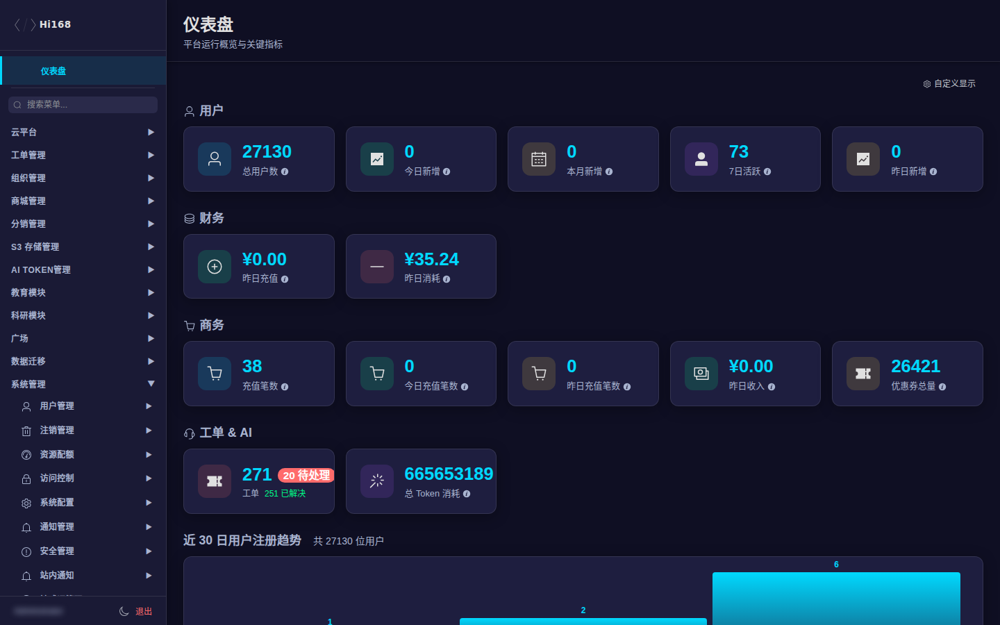

# Hi168 后台管理教程 仅授权角色可见

> 本教程面向 **Hi168 平台后台管理员**，与前台「帮助文档」分开维护。
> 教程页本身受独立权限保护：只有被管理员显式分配 **「后台管理教程访问权限」** 的角色才能打开。
> 未授权时，即使知道地址也会看到「无权限访问后台管理教程」提示页。

## 一、适用对象

| 角色 | 典型工作 |
| --- | --- |
| 超级管理员（888） | 全平台配置、角色与权限、发布与审计 |
| 平台运维 | 云平台资源、宿主机容量、网络、拓扑、工单 |
| 教务/运营 | 课程、班级、考试、证书、大赛、直播 |
| 商务/财务 | 商品、订单、账单、优惠券、VIP、支付、分销 |
| 客服/审核 | 用户、实名认证、封禁、组织认证、内容审核 |

> 具体能看到哪些菜单，取决于角色的 **接口策略（Casbin）** 和 **菜单权限（authority_menu_keys）**，不是所有管理员都看到同一套菜单。看不到某个菜单时，先查角色权限，而不是反复刷新。

## 二、入口与登录

| 项目 | 地址/说明 |
| --- | --- |
| 后台入口 | `https://www.hi168.com/admin.html` |
| 未登录 | 自动跳转 `login.html`，登录后回到后台 |
| 前台首页 | `https://www.hi168.com/` |
| 本教程入口 | 后台左下角 **📘 后台使用教程**（仅授权角色显示），或直接访问 `https://www.hi168.com/help/admin/` |

> 后台与前台共用同一套账号。账号必须是「可进入后台」的角色：`uid=1`、`authority_id=888`，或角色持有任意 `/api/v2/admin/*` 策略。普通学生/教师账号默认进不了后台。

## 三、界面布局

| 区域 | 说明 |
| --- | --- |
| 左侧栏 | 按业务域分组：云平台、工单、组织、商城、分销、S3、AI TOKEN、教育、科研、广场、数据迁移、系统管理 |
| 菜单搜索 | 左侧「搜索菜单...」可快速定位页面，不必逐级展开 |
| 顶部标题栏 | 当前页面名称与一句话说明；右侧是页面的刷新/导出/新建等动作 |
| 内容区 | 列表、筛选、分页、表单/弹窗；大部分页面为「搜索 + 表格 + 操作按钮」结构 |
| 左下角 | 当前账号、主题切换（暗色/亮色/跟随系统）、退出；授权角色还会显示「📘 后台使用教程」 |

## 四、权限与教程入口

后台教程使用 **独立权限**，不与任何业务菜单绑定：

| 权限项 | 值 |
| --- | --- |
| 接口路径 | `/api/v2/admin/help/admin-docs/authz` |
| 方法 | `GET` |
| 默认可见 | 超级管理员（888）默认可见 |
| 其他角色 | 需要在「角色管理 → 策略」中显式勾选「后台管理教程访问权限」 |

完整分配步骤、验证方法和常见问题见 [权限与访问入口](./access-control)。

## 五、教程目录

| 章节 | 内容 |
| --- | --- |
| [权限与访问入口](./access-control) | 角色、权限策略、菜单权限、本教程权限的分配与验证 |
| [云平台](./cloud-platform) | 应用、应用审批、部署/快照、可用区/命名空间、规格、宿主机与容量、网络、拓扑、工单 |
| [组织管理](./organization) | 组织列表、余额、计费、企业认证、发票、统计 |
| [商城与分销](./commerce) | 商品、订单、账单统计、优惠券、余额、资源计费、VIP、支付、分销 |
| [S3 存储与 AI 模型](./storage-ai) | 服务器账号/子账号、配额、存储桶、流量与速率、计费权益、AI 模型数据集 |
| [AI TOKEN 管理](./llm) | 供应商、模型、渠道密钥、订阅套餐、用户概览/明细、统计 |
| [教育模块](./education) | 班级、教师、课程、培训、练习、考试、证书、大赛、直播、课件 |
| [科研模块](./research) | 领域、期刊、学者、论文、关键词、知识库、订阅与关注 |
| [广场管理](./community) | 动态、话题、创作者、评论 |
| [数据迁移](./migration) | Odoo/旧平台数据同步、迁移任务与日志 |
| [系统管理](./system) | 用户、注销、配额、访问控制、系统配置、通知、安全、站内通知、敏感词、权益 |
| [通用操作与 FAQ](./appendix) | 搜索/分页/导入导出/审计/常见问题 |

## 六、通用操作速查

1. **找菜单**：左侧搜索框输入名称（如「订单」「宿主机」），点击结果直接跳转。
2. **筛选列表**：内容区顶部一般有搜索框、状态下拉、时间范围；改条件后点「搜索」。
3. **看详情**：列表右侧「详情 / 编辑 / 更多」；只读查看不会改动数据。
4. **翻页**：底部可选择每页条数、输入页码或点前后页。
5. **导出**：部分列表右上角有「导出」按钮，导出范围以当前筛选条件为准。
6. **危险操作**：删除、停售、封禁、退款等按钮通常需要二次确认；生产环境操作前先确认影响范围。

> ⚠️ 本教程所有截图均来自生产环境 **只读浏览**，未创建、修改或删除任何业务数据。截图中的手机号、邮箱、姓名等个人信息已做模糊处理。

## 七、版本与反馈

- 教程随后台菜单与权限模型更新；若发现界面与文档不一致，以页面实际显示为准。
- 需要新增/调整教程权限：联系超级管理员，在「角色管理 → 策略」中分配，详见 [权限与访问入口](./access-control)。
