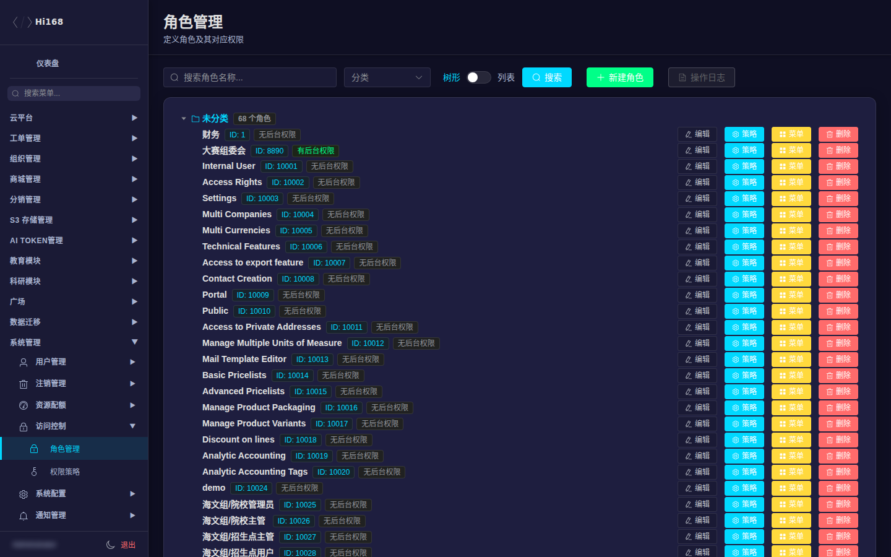
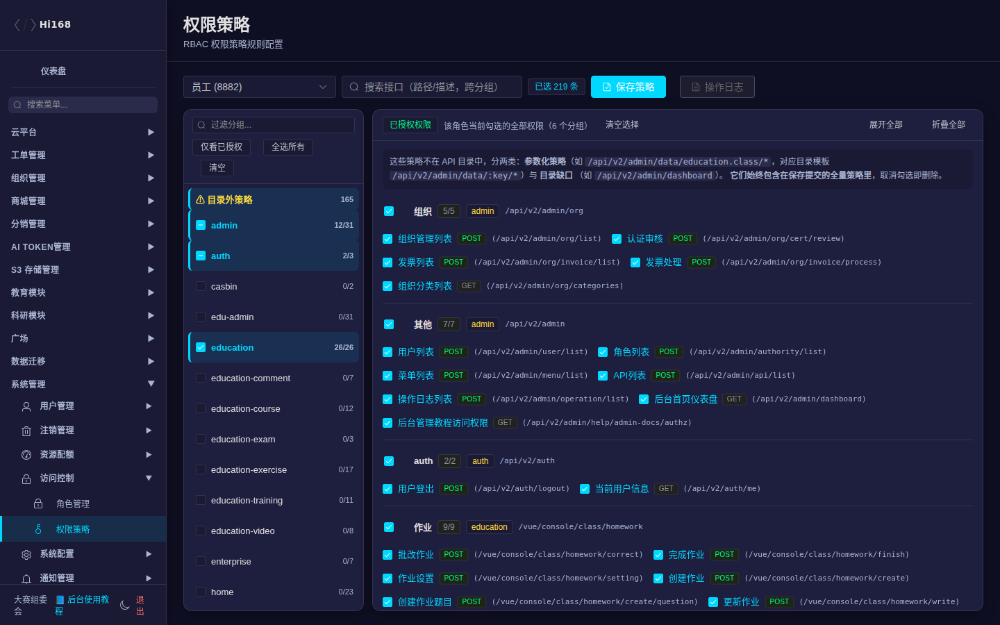
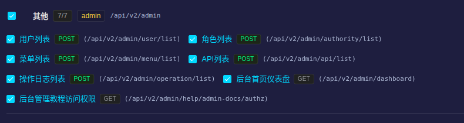
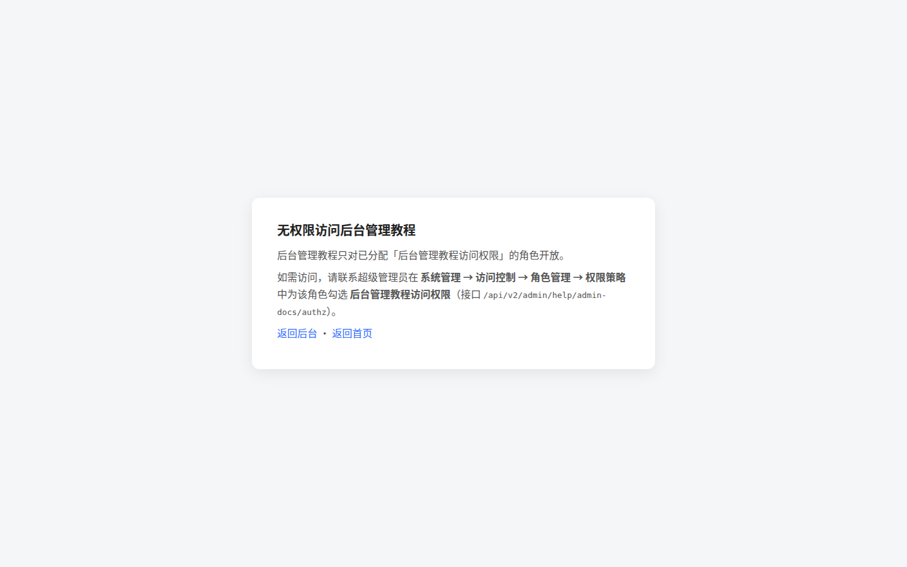

# 权限与访问入口

本章说明后台权限的三个层次，以及如何把 **后台管理教程** 分配给指定角色。后台教程默认不公开，只有被显式授权的角色才能访问。

## 一、先分清三种「权限」

| 层次 | 存储位置 | 决定什么 | 在哪里配置 |
| --- | --- | --- | --- |
| ① 后台准入 | 角色是否有任意 `/api/v2/admin/*` 策略 | 能不能打开后台 `admin.html` | 角色管理 → 策略 |
| ② 接口策略（Casbin） | `casbin_rule` | 能调用哪些后台接口（能不能操作） | 角色管理 → 策略 / 权限策略页 |
| ③ 菜单权限 | `authority_menu_keys` | 左侧栏显示哪些菜单（能看到什么） | 角色管理 → 菜单 |

> **关键区别**：接口策略和菜单权限是**解耦**的。
> - 有接口策略、没有菜单权限：能直接调接口，但侧栏没有入口。
> - 有菜单权限、没有接口策略：能看到菜单，点进去接口 403。
>
> 后台管理教程属于 **② 接口策略**，不是菜单权限；它不会出现在左侧业务菜单里，只控制教程页本身。

## 二、角色管理页面



进入路径：**系统管理 → 访问控制 → 角色管理**。

| 列/按钮 | 说明 |
| --- | --- |
| 角色名称 + ID | 角色标识；`888` 是超级管理员 |
| 「有后台权限 / 无后台权限」 | 该角色是否满足后台准入条件 |
| 编辑 | 修改角色名称、默认首页等 |
| **策略** | 配置接口权限（Casbin）——本教程权限在这里分配 |
| **菜单** | 配置左侧栏可见菜单（`authority_menu_keys`） |
| 删除 | 删除角色（危险操作，先确认没有在用账号） |

## 三、给角色分配「后台管理教程访问权限」

### 3.1 操作步骤

1. 用超级管理员（888）登录后台。
2. 打开 **系统管理 → 访问控制 → 角色管理**。
3. 找到目标角色，点该行的 **策略** 按钮。
4. 在弹窗中搜索或展开 `admin` 分组，找到：
   - 名称：**后台管理教程访问权限**
   - 接口：`GET /api/v2/admin/help/admin-docs/authz`
5. 勾选该项（只需勾选，不需要改其它已有权限）。
6. 点 **保存**。
7. 让该角色的用户 **退出后重新登录**（或刷新后台），左下角会出现 **📘 后台使用教程** 入口。





> 如果一个角色已经有很多策略，**不要使用「全选/清空」**。本页保存是「读取现有 → 合并 → 整体提交」，只勾选新增项即可，已有勾选会保持。

### 3.2 权限模型

| 角色 | 能否访问教程 | 原因 |
| --- | --- | --- |
| 超级管理员 `888` | ✅ 始终可以 | Casbin 模型对 `888` 直通，不需要额外策略 |
| 已分配本权限的角色 | ✅ | 持有 `GET /api/v2/admin/help/admin-docs/authz` |
| 未分配本权限的后台角色 | ❌ | 能进后台，但教程页返回 403 |
| 学生 / 普通教师 | ❌ | 通常连后台都进不去 |

### 3.3 取消授权

同样在 **角色管理 → 策略** 中，取消勾选 **后台管理教程访问权限** 并保存。该角色再次访问教程页会立即收到 403（已打开的页面刷新后失效）。

## 四、访问入口

### 4.1 后台左下角入口

授权角色登录后台后，左下角（主题切换按钮左侧）会出现：

```
📘 后台使用教程
```

点击会在新标签页打开 `https://www.hi168.com/help/admin/`。

### 4.2 直接访问

也可以在浏览器直接打开：

```
https://www.hi168.com/help/admin/
```

未登录会先跳转登录页；登录后如果角色没有权限，会看到下面的提示页：



> 提示页会明确写出需要分配的接口路径，方便运维排查。直接把地址发给未授权同事时，对方看到的就是这个页面，不会泄露教程内容。

## 五、验证清单

| 验证项 | 期望结果 |
| --- | --- |
| 888 登录后台左下角 | 显示「📘 后台使用教程」 |
| 已授权角色登录后台左下角 | 显示「📘 后台使用教程」 |
| 未授权角色登录后台左下角 | 不显示该入口 |
| 已授权角色直接访问 `/help/admin/` | 正常打开教程首页 |
| 未授权角色直接访问 `/help/admin/` | 403「无权限访问后台管理教程」 |
| 未登录访问 `/help/admin/` | 302 跳转登录页 |
| 普通前台帮助 `/help/` | 始终可访问，不受本权限影响 |

## 六、常见问题

| 现象 | 原因与处理 |
| --- | --- |
| 分配后左下角仍没有入口 | 先退出重新登录；浏览器强刷（Ctrl+F5）；确认保存的是当前角色，不是另一个同名角色 |
| 有入口但打开 403 | 权限策略未保存成功，或用户当前激活角色不是被授权的角色；在「策略」弹窗搜索 `admin-docs` 确认已勾选 |
| 888 也需要分配吗 | 不需要，888 直通 |
| 想给「大赛组委会 8890」开放 | 给 8890 的角色策略勾选本项即可；它已有的业务菜单不变 |
| 想完全隐藏教程地址 | 本权限只做访问控制，地址本身不是秘密；未授权用户打开只会看到 403 提示页 |
| 菜单权限里找不到「后台教程」 | 正常。教程不是业务菜单，走的是接口策略，不是 `authority_menu_keys` |
| 前台帮助文档会受影响吗 | 不会。`/help/` 仍公开，只有 `/help/admin/` 受保护 |

## 七、运维提示

- 不要把 `/api/v2/admin/help/admin-docs/authz` 加入后台「脚手架白名单」，否则所有能进后台的角色都会自动获得教程访问权。
- 批量授权建议用后台 UI 逐角色操作；如需 SQL 回填，先备份 `casbin_rule`，再插入：

```sql
INSERT INTO casbin_rule (ptype, v0, v1, v2)
SELECT 'p', '8881', '/api/v2/admin/help/admin-docs/authz', 'GET'
WHERE NOT EXISTS (
  SELECT 1 FROM casbin_rule
  WHERE ptype='p' AND v0='8881'
    AND v1='/api/v2/admin/help/admin-docs/authz' AND v2='GET'
);
```

- 回滚：删除该角色对应的这一条策略即可，不影响其它权限。
