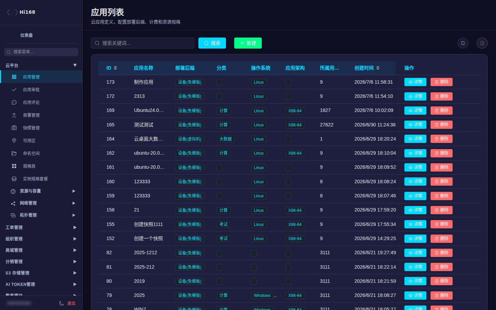
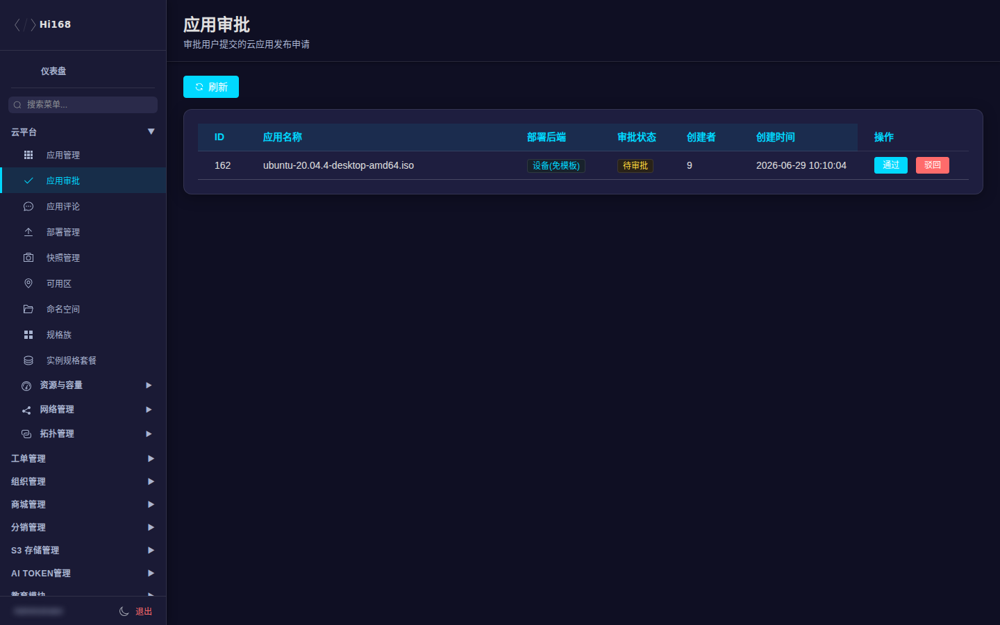
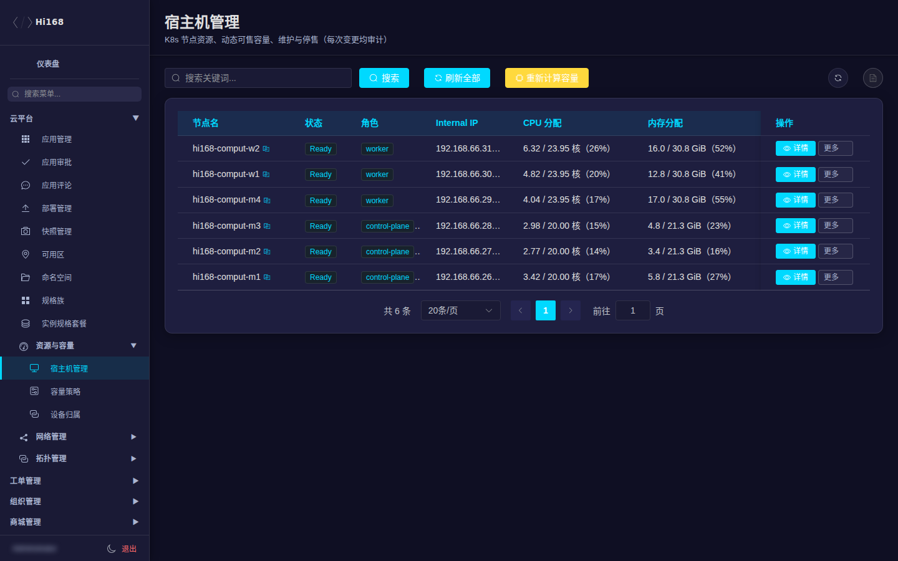
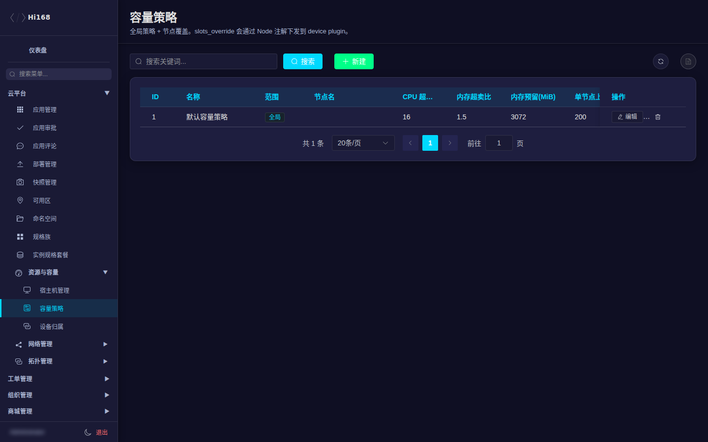
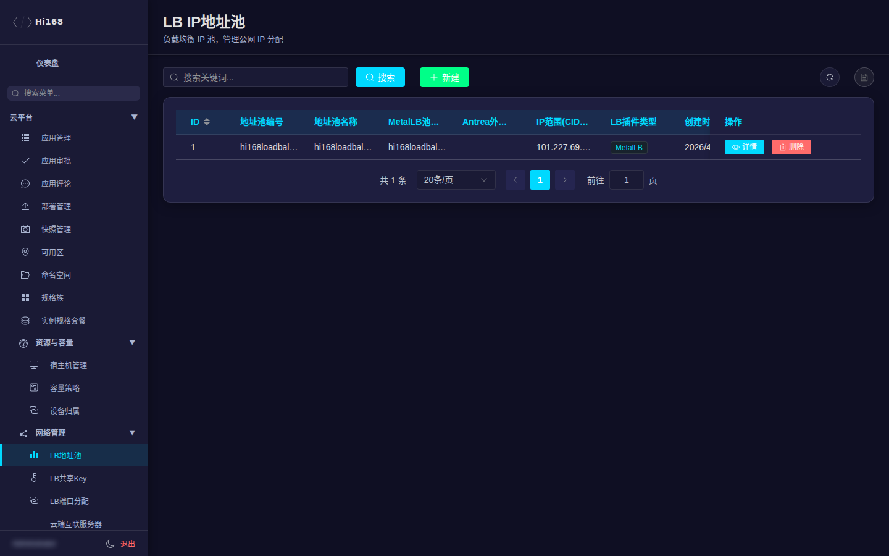
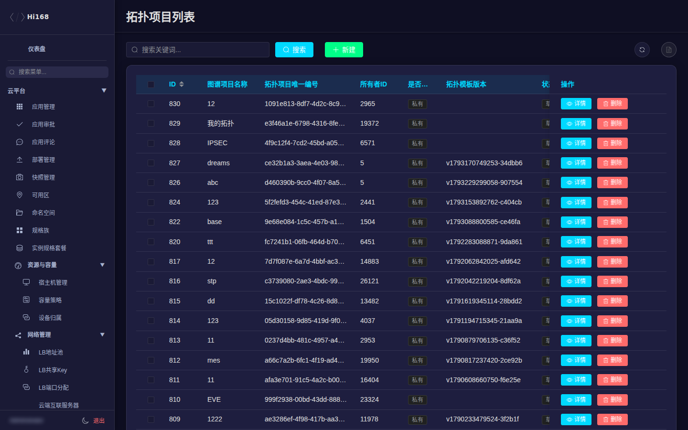
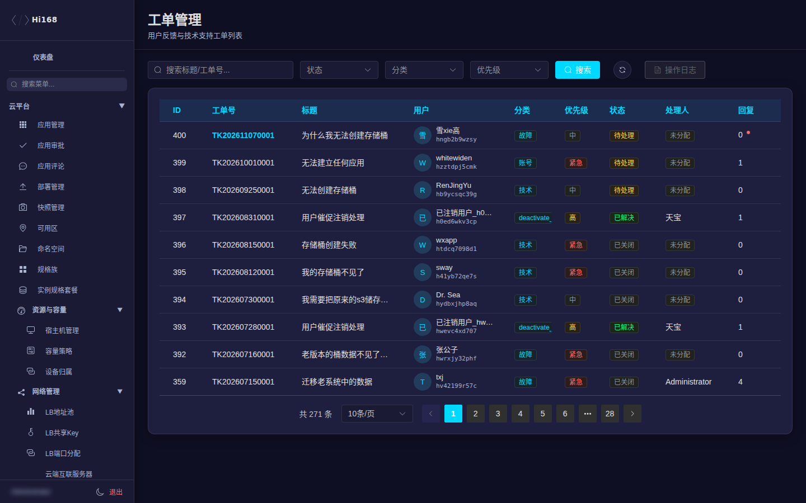

# 云平台

「云平台」是后台最核心的运营域，覆盖应用目录、应用审批、部署与快照、可用区/命名空间、规格、宿主机容量、网络、拓扑和工单。

## 一、菜单总览

| 分组 | 页面 | 主要用途 |
| --- | --- | --- |
| 应用管理 | 应用管理 | 维护应用目录、部署后端、资源规格、计费与发布状态 |
| 应用管理 | 应用审批 | 审核用户提交的云应用发布申请 |
| 应用管理 | 应用评论 | 查看/处理应用评价 |
| 应用管理 | 部署管理 | 查看用户应用的部署实例与状态 |
| 应用管理 | 快照管理 | 查看/清理应用快照 |
| 应用管理 | 可用区 / 命名空间 | 维护资源池与租户隔离空间 |
| 应用管理 | 规格族 / 实例规格套餐 | 维护可售规格与套餐 |
| 资源与容量 | 宿主机管理 | K8s 节点资源、可售容量、维护与停售 |
| 资源与容量 | 容量策略 | 全局/单节点的超卖比、预留、台数覆盖 |
| 资源与容量 | 设备归属 | 拓扑设备与宿主机归属关系 |
| 网络管理 | LB地址池 / LB共享Key / LB端口分配 | 负载均衡地址与端口资源 |
| 网络管理 | 云端互联服务器 / 客户端 | Cloud Link 服务端与客户端配置 |
| 拓扑管理 | 拓扑项目 / 历史 / 设备实例 / 设备模板 / 模板分类 / 厂商 / 仿真镜像 / 网络模板 / 团队 / 部署 / 项目分类 / 模板映射 | 网络仿真平台的目录、模板与实例 |
| 工单管理 | 工单统计 / 工单列表 | 用户工单的处理与统计 |

## 二、应用管理

### 2.1 应用列表

应用列表用于维护「应用中心」里可部署的应用。重点字段：

| 字段 | 说明 |
| --- | --- |
| 应用名称 / 图标 | 前台展示名称与图标 |
| 部署后端 | `设备(虚拟机)`、`设备(免模板)`、`StatefulSet(容器)`、`Job(一次性任务)` |
| 分类 | 计算 / 网络 / 存储 / AI / 教育 |
| 操作系统 / 应用架构 | Linux/Windows、X86-64/ARM64 |
| 发布状态 | 草稿 / 待审批 / 已通过 / 已驳回 |
| 状态 | 编辑中 / 已发布 / 已弃用 |
| 可用 | 是否在前台可部署 |
| 定价模板 / 每小时费用 | 计费依据 |
| 默认 CPU/内存/磁盘 | 用户部署时的默认规格 |
| 快照 / 挂载 / VNC / WebShell | 该应用支持的能力开关 |

> 新建/编辑应用前，先确认 **部署后端** 与 **设备模板 / StatefulSet 规格 / Job 规格** 匹配；填错会导致用户部署失败。

### 2.2 应用审批

用户提交应用发布申请后进入本页。列表字段：ID、应用名称、部署后端、审批状态、创建者、创建时间。

| 操作 | 说明 |
| --- | --- |
| 通过 | 应用进入可发布状态；检查名称、镜像/模板、规格、价格是否合规 |
| 驳回 | 填写原因，用户可修改后重新提交 |

> 审批前建议先在「应用管理」确认资源模板存在、容量足够；审批通过不等于容量自动扩容。

### 2.3 部署、快照与评论

- **部署管理**：查看部署实例、所属用户、后端类型、状态与资源占用。排查「用户应用起不来」时，先看这里的状态与错误信息。
- **快照管理**：查看应用快照、大小、创建时间与所属用户；清理前确认用户不再需要。
- **应用评论**：审核/隐藏不当评论，必要时联系用户。

## 三、可用区、命名空间与规格

| 页面 | 用途 | 注意事项 |
| --- | --- | --- |
| 可用区 | 划分资源池/故障域 | 变更前确认存量应用归属 |
| 命名空间 | 租户/项目隔离 | 删除前确认无应用与存储 |
| 规格族 | 规格分组（如通用型、计算型） | 影响前台规格展示 |
| 实例规格套餐 | 具体 CPU/内存/价格组合 | 与计费模板保持一致 |

## 四、资源与容量

### 4.1 宿主机管理

展示 K8s 节点（NVIDIA/计算节点）的 **静态资源、实际用量和可售容量**，并进行维护/停售操作。

| 字段 | 说明 |
| --- | --- |
| 节点名 / 状态 / 角色 | 节点标识、Ready 状态、control-plane/worker |
| Internal IP | 节点内网地址（截图已省略尾部） |
| CPU 分配 / 内存分配 | 已分配 requests 与节点总容量、占比 |
| 实际 CPU / 实际内存 | node-exporter 实时指标 |
| 设备（已用/可售） | KVM 设备槽位使用情况 |
| 可售余量 / 售罄 / 维护 / 容量状态 | 是否还能卖出、是否维护、容量来源（自动/手动/离线） |

| 操作 | 作用 |
| --- | --- |
| 详情 | 查看节点指标、容量公式明细、设备列表 |
| 容量设置 | 自动 / 手动 / 离线；手动值会写 Node 注解并下发给 device plugin |
| 维护模式 | cordon + 污点 + 容量置 0，阻止新设备调度 |
| 停售 / 开售 | 容量置 0 或恢复，影响前台可售台数 |
| 刷新全部 / 重新计算容量 | 立即采集与重算；变更均写审计 |

> ⚠️ 维护/停售会影响用户下单与设备启动。操作前确认节点上没有正在交付的订单，并记录原因。

### 4.2 容量策略

| 字段 | 说明 |
| --- | --- |
| 范围 | 全局 `global` 或单节点 `node` |
| CPU 超卖比 / 内存超卖比 | 可售容量的超卖系数（生产口径以页面实际为准） |
| 内存预留 / 最小可售内存 | 预留与最小可售粒度 |
| 单节点上限 | 每节点最多可售设备数 |
| 容量覆盖（台） | 直接指定可售台数，会通过 Node 注解下发 |
| 启用 | 是否生效 |

> 容量公式、Pod requests、准入校验必须使用同一口径；改比例前先和平台负责人确认，避免超卖或售罄。

### 4.3 设备归属

展示拓扑设备实例与宿主机的归属关系，用于排查「设备在哪台节点上」「状态是否陈旧」。只读核对为主，不要直接改归属。

## 五、网络管理

| 页面 | 用途 |
| --- | --- |
| LB地址池 | 维护负载均衡可用 IP 段与使用状态 |
| LB共享Key | 多租户共享 LB 的授权 Key |
| LB端口分配 | 查看端口占用与分配记录 |
| 云端互联服务器 | Cloud Link 服务端节点/配置 |
| 云端互联客户端 | 用户侧客户端接入记录 |

> 删除/回收 IP 或端口前，确认没有在线服务占用；变更会影响用户网络连通性。

## 六、拓扑管理

拓扑管理承载网络仿真平台：

| 页面 | 用途 |
| --- | --- |
| 拓扑项目 / 历史 | 用户拓扑项目与变更历史 |
| 设备实例 | 运行中的仿真设备（QEMU/容器） |
| 设备模板 | 可上架的仿真设备模板（含镜像、端口、资源配置） |
| 模板分类 / 厂商管理 / 仿真镜像 | 模板目录与镜像来源 |
| 网络模板 | 预置网络拓扑 |
| 团队管理 | 团队/协作空间 |
| 部署管理 | 拓扑部署实例 |
| 项目分类 / 模板映射 | 分类与模板匹配规则 |

> 设备模板的镜像、PVC 与资源规格是强依赖；下线模板前先确认没有运行中的设备实例。容器型 VNC 控制台当前不支持，排障时不要误判为用户网络问题。

## 七、工单管理

| 页面 | 用途 |
| --- | --- |
| 工单统计 | 工单量、状态分布、处理时长 |
| 工单列表 | 查看/回复/关闭用户工单 |

处理建议：

1. 先看工单分类与用户描述，必要时查看关联资源（应用/存储/订单）。
2. 回复时写清处理结果与后续动作。
3. 关闭前确认用户问题已解决；批量关闭前先筛选，避免误关。

## 八、常见问题

| 现象 | 排查方向 |
| --- | --- |
| 用户应用部署失败 | 部署管理看状态；确认应用发布状态、设备模板/规格、命名空间容量 |
| 应用前台不可见 | 应用管理检查「可用」「发布状态」「状态」三个开关 |
| 宿主机显示售罄但实际有空闲 | 容量策略/手动覆盖/维护模式；看节点注解与 device plugin 回写值 |
| 拓扑设备起不来 | 设备实例状态、模板镜像/PVC、节点容量与 agent 是否在线 |
| LB 地址冲突 | 地址池、端口分配、共享 Key 三处一起核对 |
