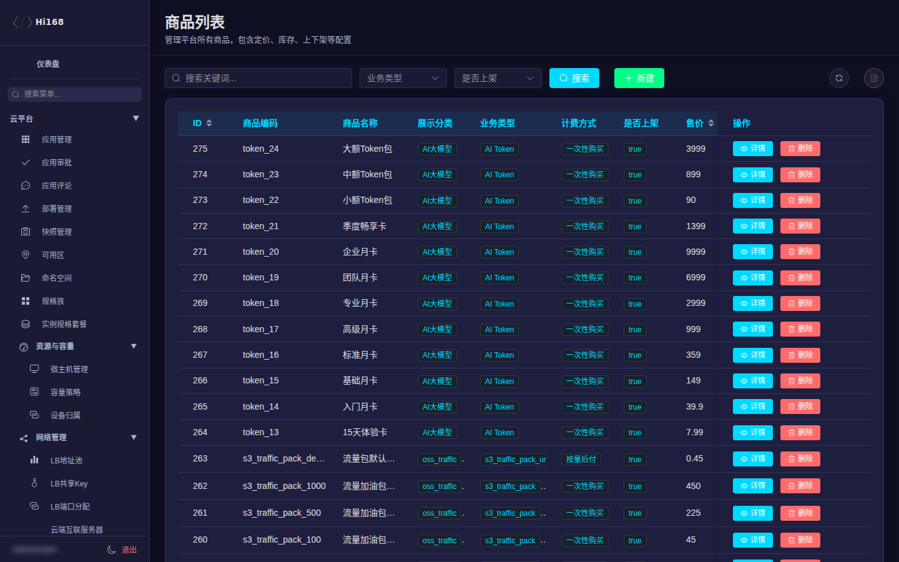
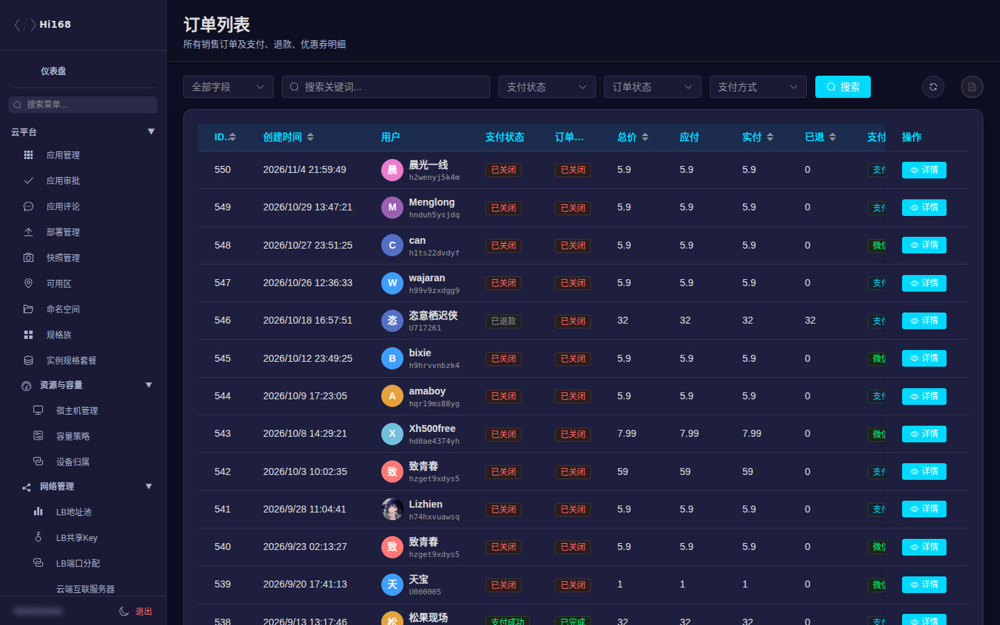
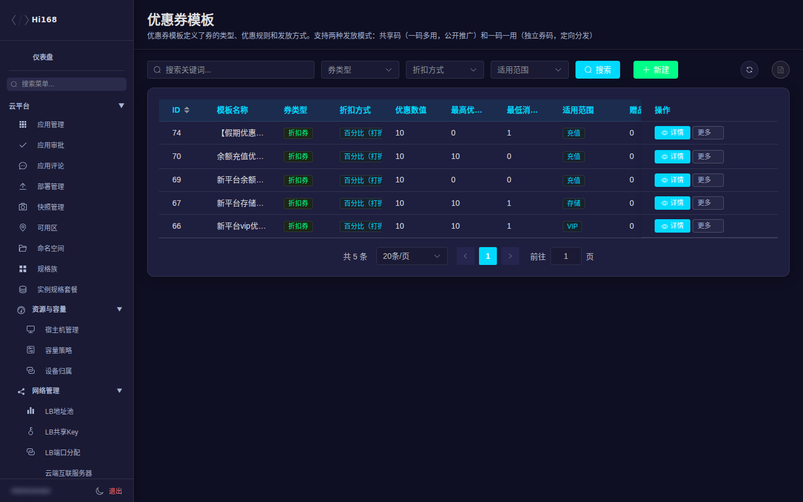
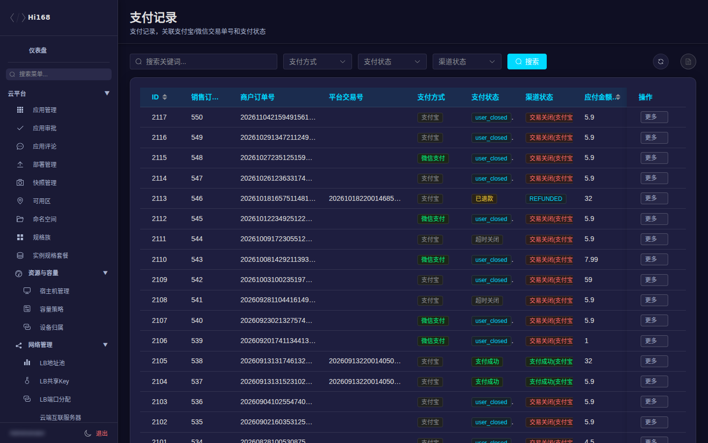
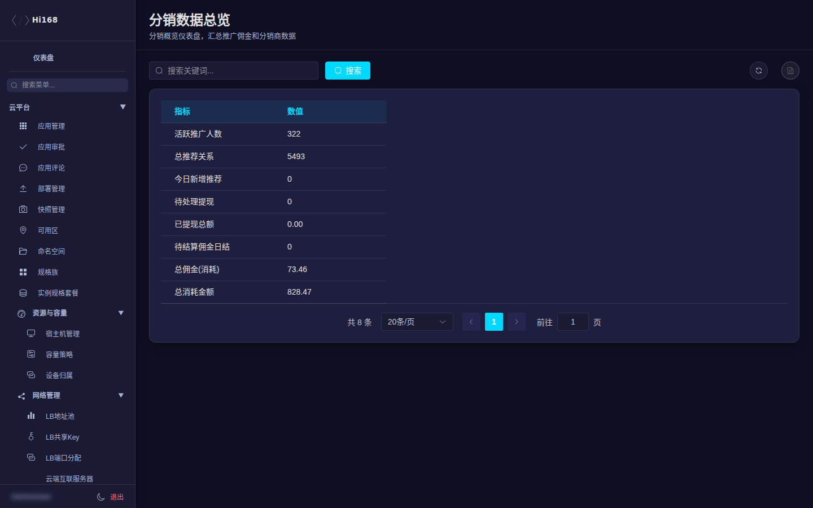

# 商城与分销

商城管理覆盖商品、订单、账单、优惠券、余额、资源计费、VIP、支付；分销管理覆盖推广关系、佣金与提现。

## 一、菜单总览

| 分组 | 页面 | 用途 |
| --- | --- | --- |
| 商品管理 | 商品列表 | 商品、价格、库存、上下架 |
| 订单管理 | 订单列表 / 订单行 | 订单与明细 |
| 账单统计 | 统计总览 / 月度消费 / 用户消费排行 / 资源类型统计 / 归档账单 | 经营数据 |
| 优惠券管理 | 优惠券模板 / 实例 / 记录 / 发放规则 / 分销优惠券 | 优惠券生命周期 |
| 用户余额 | 用户余额 / 余额流水 | 余额查询与流水 |
| 资源计费 | 计费订阅 / 变更日志 / 待处理操作 / 定价项 / 定价模板 | 订阅计费 |
| VIP会员 | VIP套餐 / 权益模板 / VIP会员 / 权益日志 | 会员体系 |
| 支付管理 | 支付记录 / 退款记录 / 审计日志 / 对账差异 | 支付与对账 |
| 分销管理 | 分销看板 / 共创分销 / 推荐关系 / 消耗佣金日结 / 分销订单 / 提现申请 / 收款账号 | 分销运营 |

## 二、商品管理

| 字段 | 说明 |
| --- | --- |
| 商品编码 / 名称 | 唯一编码与展示名 |
| 展示分类 | 培训、课程、应用、VIP、余额充值、资源配额、存储、云主机、AI大模型 |
| 业务类型 | 课程、考试、培训、云主机、AI Token、S3 各存储层级、VIP、认证、社区、科研、充值、算力 |
| 计费方式 | 一次性购买 / 周期订阅 / 按量后付 |
| 售价 / 划线价 / 时长 | 价格与有效期 |
| 库存 | 可售数量；为空表示不限 |
| 上架 | 是否在前台可购买 |
| 分类 / 图片 / 描述 | 前台展示信息 |
| 扩展字段(JSON) | 业务扩展参数 |

> 改价前确认是否影响已订阅用户；下架商品不会自动退款，已购买权益仍按原规则生效。

## 三、订单管理

| 字段 | 说明 |
| --- | --- |
| 创建时间 / 用户 | 下单时间与下单人 |
| 支付状态 | 待支付 / 支付成功 / 已关闭 / 已退款 |
| 订单状态 | 交易中 / 已完成 / 已关闭 |
| 总价 / 应付 / 实付 / 已退 | 金额口径 |
| 支付方式 | 支付宝 / 微信 / 余额 |
| 优惠券抵扣 | 券抵扣金额 |
| 订单号 / 订单名称 | 对外查询标识 |
| 备注 / 关闭原因 | 内部记录与关单原因 |

> 「订单行」是订单的商品明细，排查「金额不对」时订单头和订单行一起看。

## 四、账单统计

| 页面 | 说明 |
| --- | --- |
| 统计总览 | 收入、订单、用户、资源等核心指标 |
| 月度消费统计 | 按月汇总 |
| 用户消费排行 | 消费 TOP 用户 |
| 资源类型统计 | 按资源类型拆分 |
| 归档账单汇总 | 超过 12 个月的历史账单 |

> 报表数字受筛选时间、订单状态影响，导出前确认筛选条件与统计口径。

## 五、优惠券

| 页面 | 说明 |
| --- | --- |
| 优惠券模板 | 面额、门槛、有效期、适用范围 |
| 优惠券实例 | 已发放到用户的券及状态 |
| 优惠券记录 | 领取/使用/失效流水 |
| 发放规则 | 自动发放条件 |
| 分销优惠券 | 分销专用券 |

> 修改模板不会改变已发放实例；需要回收时在实例维度处理。

## 六、用户余额与资源计费

| 页面 | 说明 |
| --- | --- |
| 用户余额 | 余额、冻结、最近变动 |
| 余额流水 | 充值/扣费/退款明细 |
| 计费订阅 | 周期订阅实例 |
| 计费变更日志 | 规格/价格变更记录 |
| 待处理操作 | 需要人工确认的计费动作 |
| 定价项 / 定价模板 | 计费单价与组合模板 |

> 手工调余额属于高敏感操作；必须记录原因、审批人，并核对流水。

## 七、VIP 会员

| 页面 | 说明 |
| --- | --- |
| VIP套餐 | 价格、周期、包含权益 |
| VIP权益模板 | 权益定义 |
| VIP会员 | 当前会员与到期时间 |
| VIP权益日志 | 发放/使用记录 |

## 八、支付管理

| 页面 | 说明 |
| --- | --- |
| 支付记录 | 支付单号、渠道、金额、状态 |
| 支付退款记录 | 退款单与退款状态 |
| 支付审计日志 | 回调、重试、异常记录 |
| 对账差异 | 平台与渠道金额/状态不一致的记录 |

对账建议：

1. 先按支付单号/订单号定位。
2. 核对渠道回调与平台订单状态。
3. 退款失败时看审计日志中的渠道返回码。
4. 「对账差异」不要直接改订单，先确认渠道侧真实状态。

## 九、分销管理

| 页面 | 说明 |
| --- | --- |
| 分销看板 | 推广、转化、佣金汇总 |
| 共创分销 | 共创活动与分成规则 |
| 推荐关系 | 谁推荐了谁、绑定时间 |
| 消耗佣金日结 | 按日结算的佣金 |
| 分销订单 | 产生佣金的订单 |
| 提现申请 | 分销提现审核与打款 |
| 收款账号 | 分销员收款信息 |

> 提现审核要核对实名信息、可提现余额、风控状态；打款后回填凭证。

## 十、常见问题

| 现象 | 排查 |
| --- | --- |
| 用户支付成功但订单未完成 | 支付记录 → 订单状态 → 支付审计日志 |
| 优惠券不可用 | 模板门槛/适用范围/有效期；实例状态；是否已用 |
| 余额扣费异常 | 余额流水 + 计费订阅 + 定价项 |
| 分销佣金未到账 | 推荐关系、分销订单、消耗佣金日结、提现状态逐层核对 |
| 对账差异持续存在 | 渠道回调丢失/重复；联系支付渠道并保留日志 |
