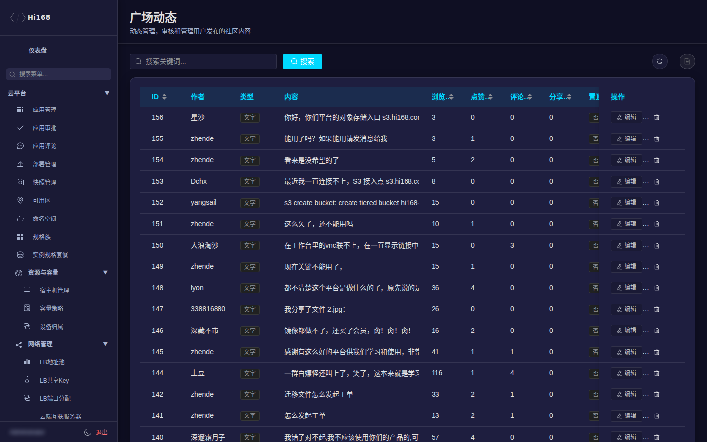

# 广场管理

「广场」是平台的社区内容区，后台提供动态、话题、创作者和评论的管理能力。

## 一、菜单总览

| 页面 | 说明 |
| --- | --- |
| 动态管理 | 用户发布的文字/图片/视频/文章；置顶、推荐、隐藏、审核 |
| 话题管理 | 话题名称、描述、封面、状态 |
| 创作者管理 | 创作者认证、等级、权益 |
| 评论管理 | 评论审核、隐藏、删除 |

## 二、动态管理

| 字段 | 说明 |
| --- | --- |
| 作者 | 发布人 |
| 类型 | 文字 / 图片 / 视频 / 文章 |
| 内容 | 正文（可能较长） |
| 浏览 / 点赞 / 评论 / 分享 | 互动数据 |
| 置顶 / 推荐 | 是否置顶、是否推荐到首页 |
| 状态 | 已发布 / 草稿 / 隐藏 / 待审核 |
| 发布时间 | 首次发布时间 |

常用操作：

1. 按作者、类型、状态、关键词筛选。
2. 对待审核内容先看正文与附件，再通过/隐藏。
3. 置顶/推荐会影响首页曝光，操作前确认内容合规。
4. 隐藏/删除前保留截图或记录原因，便于申诉处理。

> 社区内容可能含图片/视频，审核时注意违规内容识别；不要把未审核内容直接推荐到首页。

## 三、话题管理

| 字段 | 说明 |
| --- | --- |
| 话题名称 / 描述 | 前台展示 |
| 封面 | 话题图 |
| 状态 | 启用/停用 |
| 动态数 | 关联内容数量 |

## 四、创作者管理

用于创作者认证、等级与权益配置。认证前核对身份材料；取消认证会影响创作者权益与展示。

## 五、评论管理

按内容/作者/时间筛选，支持隐藏或删除。批量操作前先确认筛选条件，避免误删正常评论。

## 六、常见问题

| 现象 | 处理 |
| --- | --- |
| 用户看不到自己的动态 | 状态是否为草稿/隐藏/待审核；是否被删除 |
| 首页推荐不生效 | 是否设置推荐、话题/分类是否正确、缓存是否刷新 |
| 评论被隐藏 | 审核状态、敏感词命中、人工操作记录 |
| 创作者认证失败 | 材料是否齐全、身份是否匹配、是否重复认证 |
