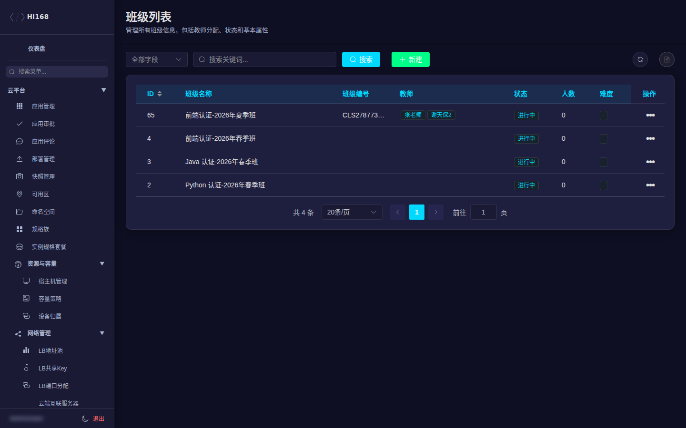
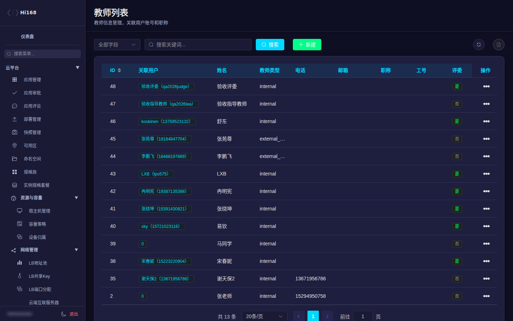
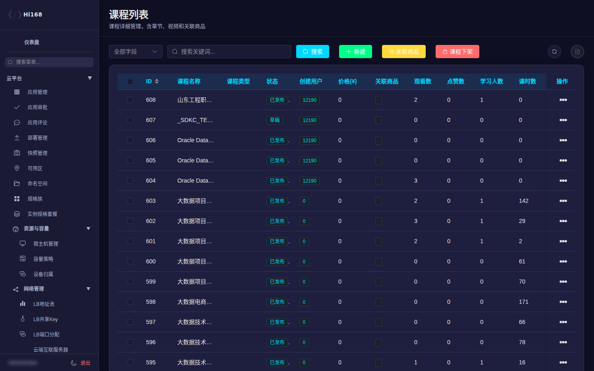
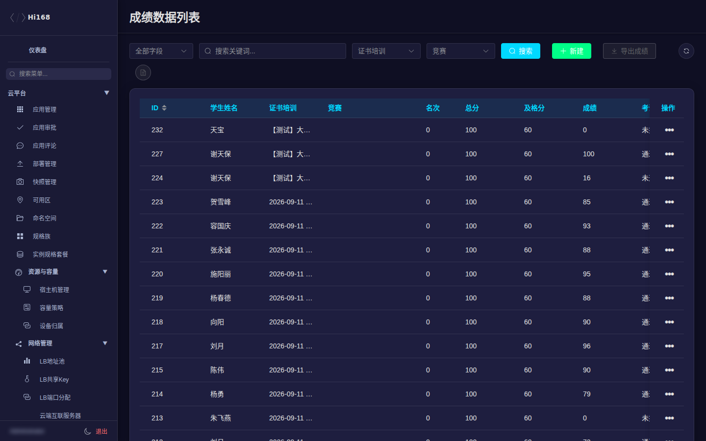
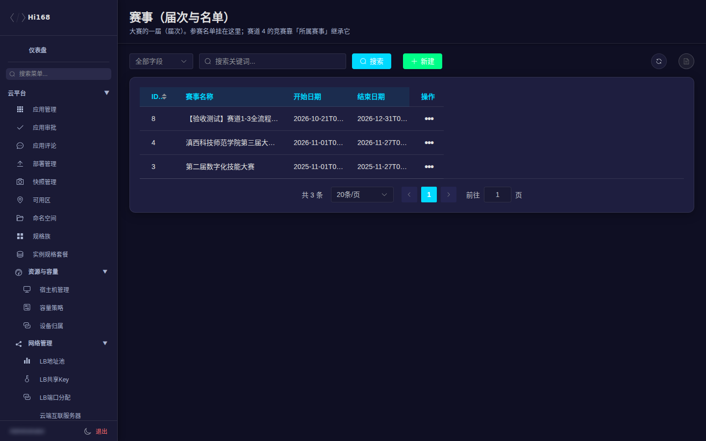

# 教育模块

教育模块覆盖班级、教师、课程、培训、练习、考试、证书、大赛、直播、课件与学习记录。它是后台菜单最多、业务链路最长的一组，建议按「基础数据 → 课程 → 班级 → 考试/证书 → 大赛」的顺序理解和配置。

## 一、菜单总览

| 分组 | 页面 |
| --- | --- |
| 教学基础 | 班级管理、教师管理、课程学习列表、课程类型、课程分类、培训管理 |
| 练习 | 练习卷管理、练习题管理、练习记录 |
| 教学资源 | 课程视频管理、课程课件、实训管理、直播管理 |
| 就业 | 招聘管理、企业管理、新闻管理 |
| 考试与证书 | 证书培训列表、证书荣誉列表、试卷配置列表、考试题库列表、成绩数据列表、用户认证记录 |
| 大赛管理 | 赛事（届次与名单）、参赛作品（赛道1-3）、赛道4 在线答题、赛道4 现场赛·参赛队伍、赛道4 现场赛·赛程对阵 |
| 学习数据 | 学员视频观看表 |

## 二、班级管理

| 字段 | 说明 |
| --- | --- |
| 班级名称 / 编号 | 展示名与业务编号 |
| 班级图片 | 前台展示图 |
| 教师 | 可多选；关联教师账号 |
| 状态 | 进行中 / 已归档 |
| 人数 | 班级人数 |
| 难度 | 入门 / 初级 / 中级 / 高级 |

> 班级的「课程」与「学生」是两条独立关系：先把教师、课程准备好，再把学生加入班级。归档班级不影响历史学习记录。

## 三、教师管理

| 字段 | 说明 |
| --- | --- |
| 关联用户 | 平台账号（`user_id`） |
| 姓名 / 电话 / 邮箱 | 教师联系方式 |
| 教师类型 | 内部/外聘等（外聘教师通常不能进后台） |
| 职称 / 工号 | 人事信息 |
| 评委 | 是否具备作品评审资格 |

> 平台判断「是不是老师」主要看教师记录与关联账号，不是只看 `user_type`。新增老师时务必关联真实用户，避免出现 `user_id=0` 的孤儿记录。

## 四、课程

| 字段 | 说明 |
| --- | --- |
| 课程名称 / Logo | 前台展示 |
| 课程类型 | 可多选 |
| 状态 | 草稿 / 审核中 / 已发布 / 已下架 / 已完成 |
| 创建用户 | 课程创建人 |
| 价格 / 关联商品 | 售价与商城商品 |
| 观看数 / 点赞数 / 学习人数 | 学习数据 |
| 课时数 / 视频数 | 内容数量（以实际课时为准） |
| 学分 / 简介 / 描述 | 课程信息 |

课程相关页面：

| 页面 | 说明 |
| --- | --- |
| 课程类型 | 课程分类的上层（如认证课、公开课） |
| 课程分类 | 更细的目录分类 |
| 培训管理 | 证书培训/批次，是考试与证书的载体 |
| 课程视频管理 | 视频资源与播放地址 |
| 课程课件 | 课时附件（URL 引用或上传） |

> 前台是否可见主要看 **课程状态**；价格要同时核对课程价格与关联商品价格。「课时数/视频数」是冗余统计，判断有没有内容以课时列表为准。

## 五、培训、练习与考试

| 页面 | 说明 |
| --- | --- |
| 培训管理 | 培训批次、关联课程、考试与证书 |
| 练习卷管理 | 练习卷（章节/课程） |
| 练习题管理 | 题目、选项、答案、解析 |
| 练习记录 | 学生练习作答与得分 |
| 试卷配置列表 | 考试试卷、题目抽取规则、时间窗 |
| 考试题库列表 | 题库与题目导入 |
| 成绩数据列表 | 考试成绩、批阅状态、导出 |
| 证书培训列表 | 培训与证书发放 |
| 证书荣誉列表 | 已发放证书/荣誉 |
| 用户认证记录 | 用户认证与审核记录 |

### 5.1 成绩数据

常见操作：

1. 按培训/批次、考试、关键字筛选。
2. 查看答卷详情、客观题得分与主观题批阅状态。
3. 导出成绩（导出范围以当前筛选为准）。
4. 需要人工批阅时进入答卷详情，按题目打分并保存。

> 已定稿的试卷通常不能再改；批阅前确认考试时间窗和交卷状态。手机号等敏感字段在导出/截图时注意脱敏。

### 5.2 考试配置

- **题库**：先导入题目，注意题型、答案、分值与解析。
- **试卷**：设置题目来源（固定/随机抽取）、总分、时长、时间窗、次数。
- **培训**：把课程、试卷、证书串起来；报名/名单在培训或班级维度维护。
- **发布**：发布前用测试账号完整走一遍「报名 → 开考 → 交卷 → 批阅 → 出证」。

## 六、大赛管理

| 页面 | 说明 |
| --- | --- |
| 赛事（届次与名单） | 赛事批次、赛道、参赛名单 |
| 参赛作品（赛道1-3） | 作品提交、审核、评审、推荐 |
| 赛道4 在线答题 | 在线个人限时答题配置与成绩 |
| 赛道4 现场赛·参赛队伍 | 现场赛队伍 |
| 赛道4 现场赛·赛程对阵 | 对阵/赛程安排 |

发布前检查：

1. 赛事时间、赛道、报名名单是否完整。
2. 作品赛道：评分维度、评委、推荐规则。
3. 赛道4：题库、试卷、限时、次数、现场队伍与对阵。
4. 证书/荣誉：发放规则与模板。
5. 用测试账号验证报名、答题、交卷、评分、导出。

> 大赛涉及现场演示，变更尽量在赛前完成并冻结；比赛期间只做必要的名单/状态修正，不做结构性改动。

## 七、直播、课件与学习数据

| 页面 | 说明 |
| --- | --- |
| 直播管理 | 直播间、开播时间、讲师、状态 |
| 课程课件 | 课时附件与下载 |
| 学员视频观看表 | 观看进度、时长、完成情况 |
| 用户认证记录 | 认证申请与审核结果 |

> 学员「没看完/不显示成绩」时，先核对观看记录、课时挂载和课程状态，再判断是否是前端显示问题。

## 八、就业与内容

| 页面 | 说明 |
| --- | --- |
| 招聘管理 | 岗位、企业、投递 |
| 企业管理 | 招聘企业信息 |
| 新闻管理 | 平台公告/资讯 |

## 九、常见问题

| 现象 | 排查 |
| --- | --- |
| 学生看不到课程 | 课程状态、班级/报名关系、课程是否关联培训 |
| 老师看不到班级 | 教师是否关联正确账号、是否被分配到班级 |
| 考试无法开考 | 试卷发布时间窗、题目/总分、报名名单、次数限制 |
| 成绩为空/不显示 | 是否交卷、是否批阅、成绩是否回写、课程/培训关联 |
| 证书未发放 | 培训完成条件、成绩通过、证书模板与发放记录 |
| 直播进不去 | 直播状态、开始时间、访问权限、推拉流地址 |
| 课件打不开 | 文件 URL、权限、格式与大小限制 |
