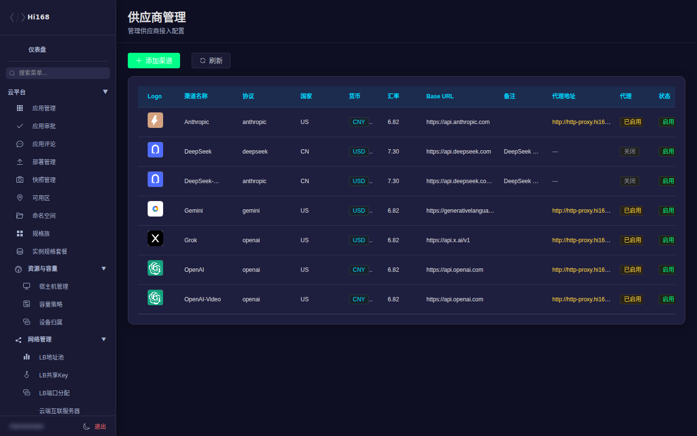
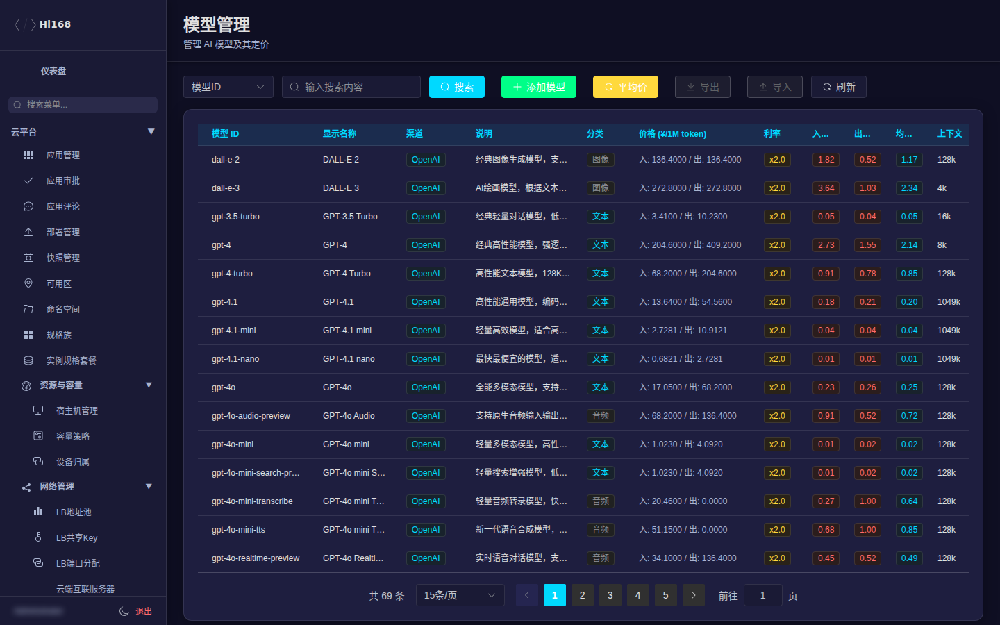
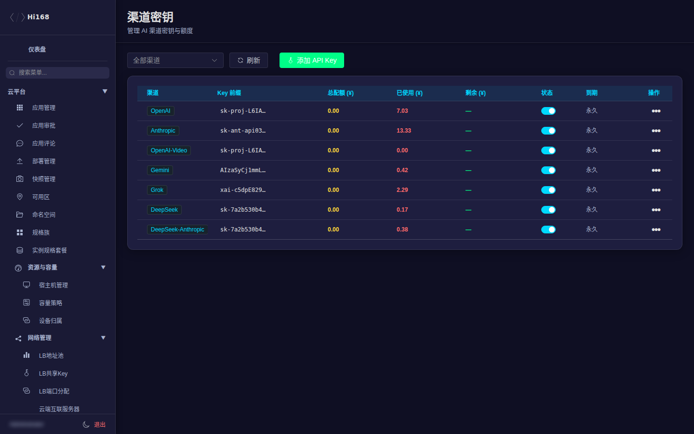
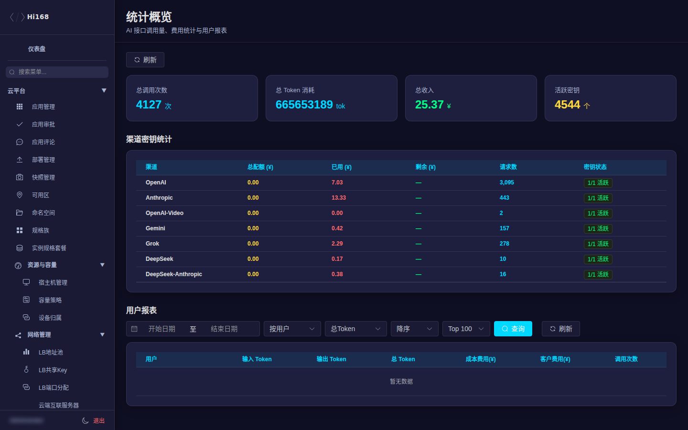

# AI TOKEN 管理

AI TOKEN 管理用于维护大模型供应商、模型目录、渠道密钥、订阅套餐，并查看用户的 Token 使用与账单。

## 一、菜单总览

| 页面 | 用途 |
| --- | --- |
| 供应商管理 | 上游模型供应商与接入地址 |
| 模型管理 | 可售/可用模型、上下文长度、价格 |
| 渠道密钥 | 供应商侧 API Key、权重、限流 |
| 订阅套餐 | 面向用户的 Token 套餐 |
| 用户概览 | 用户 Token 余额、订阅、用量 |
| 订阅记录 | 套餐购买与续费记录 |
| 用户明细 | 单用户的调用/消费明细 |
| 统计概览 | 调用量、Token 消耗、收入趋势 |

## 二、供应商管理

| 字段 | 说明 |
| --- | --- |
| 供应商名称 | 如 DeepSeek、OpenAI 兼容网关等 |
| 接入地址 / 协议 | API Base URL 与协议类型 |
| 状态 | 启用/停用 |
| 备注 | 计费/额度/联系人等内部说明 |

> 供应商不可用时，先确认上游状态、网络连通和密钥是否过期，再考虑切换渠道。

## 三、模型管理

| 字段 | 说明 |
| --- | --- |
| 模型名称 / 标识 | 前台展示名与调用标识 |
| 供应商 | 归属供应商 |
| 上下文长度 | 最大上下文 |
| 输入/输出价格 | Token 计价 |
| 状态 | 上架/下架 |
| 能力标签 | 对话、推理、视觉等 |

> 下架模型前确认是否仍有用户订阅/调用；必要时先通知并保留过渡期。

## 四、渠道密钥

| 字段 | 说明 |
| --- | --- |
| 渠道名称 | 密钥所属渠道 |
| Key | 供应商 API Key（敏感，界面通常脱敏） |
| 权重 / 优先级 | 多 Key 负载分配 |
| 状态 | 启用/禁用/异常 |
| 最后使用 / 错误 | 运行状态 |

> Key 属于最高敏感级别：不要截图明文、不要写进工单或聊天；轮换时先加新 Key，再禁用旧 Key。

## 五、订阅套餐与用户

| 页面 | 说明 |
| --- | --- |
| 订阅套餐 | 套餐名称、包含 Token、有效期、价格 |
| 用户概览 | 用户当前套餐、剩余 Token、累计消耗 |
| 订阅记录 | 购买、续费、退款 |
| 用户明细 | 单用户调用记录、模型、Token 数、费用 |

> 用户反馈「额度不对」时，按「用户概览 → 订阅记录 → 用户明细」三层核对。

## 六、统计概览

关注指标：

- 调用量/成功率：异常下跌先看供应商与渠道 Key。
- Token 消耗：按模型/用户拆分，识别异常大用量。
- 收入/成本：核对套餐销售与上游成本。
- 错误率：渠道限流、超时、鉴权失败。

## 七、常见问题

| 现象 | 排查 |
| --- | --- |
| 用户调用报鉴权失败 | 渠道 Key 状态、供应商鉴权、用户 Token 是否有效 |
| 调用超时/限流 | 供应商状态、渠道权重、限流配置 |
| 用户余额与用量不一致 | 订阅记录 + 用户明细，确认是否有赠送/退款 |
| 模型不可选 | 模型状态、供应商状态、套餐是否包含 |
| 想换供应商 Key | 先新增 Key 并启用，验证后再禁用旧 Key，避免中断 |
