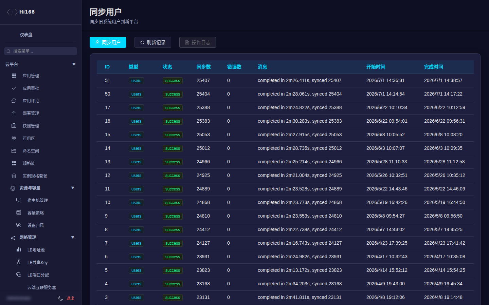
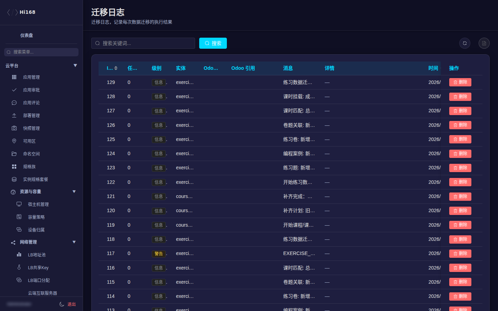

# 数据迁移

> ⚠️ **模块状态：2026-11-08 起暂时下架。** 后台左侧栏不再显示「数据迁移」分组，`/api/v2/admin/migration/*` 接口也不再注册。以下内容保留，供模块恢复后参考；当前生产请勿按本文操作。

数据迁移用于把旧平台（Odoo / 旧 hi168）的数据同步到新平台。**这是后台风险最高的一组功能**：多数按钮会直接写生产库，操作前必须确认环境、范围、幂等性和回滚方案。

## 一、菜单总览

| 页面 | 说明 |
| --- | --- |
| 同步用户 | 从旧库同步用户/账号 |
| 分销数据迁移 | 分销关系、佣金等 |
| S3 数据迁移 | 对象存储账号/桶/文件 |
| 同步权限组 | 旧权限组/角色映射 |
| 全量同步 | 批量执行多类同步 |
| 拓扑同步 | 拓扑项目/模板/设备 |
| VIP迁移 | 会员与权益 |
| 课程迁移 | 课程/章节/课时 |
| 课程关联用户迁移 | 报名/学习关系 |
| 练习数据迁移 | 练习卷/题/记录 |
| 课件迁移 | 课时附件 |
| 连接配置 | 旧库/目标库连接信息 |
| 迁移日志 | 每次迁移的结果与错误 |
| 迁移任务 | 迁移任务队列与状态 |

## 二、同步用户

| 字段 | 说明 |
| --- | --- |
| 状态 | 成功/失败/跳过 |
| 旧 ID | 旧平台用户 ID |
| 新 ID | 新平台用户 ID |
| 邮箱/手机 | 匹配依据 |
| 同步时间 | 执行时间 |
| 错误信息 | 失败原因 |

> 同步用户前先确认旧库连接配置、目标库环境、幂等键（旧 ID/邮箱/手机）。生产执行前先在测试环境跑一遍。

## 三、连接配置

用于保存旧平台/目标平台的数据库或 API 连接信息。凭证属于敏感信息：

- 不要在截图、工单、聊天中暴露密码。
- 修改连接前记录原值。
- 连接测试失败先查网络、账号权限、库名。

## 四、迁移任务与日志

| 页面 | 说明 |
| --- | --- |
| 迁移任务 | 任务类型、开始/结束时间、状态、进度 |
| 迁移日志 | 成功/失败条数、错误详情、可重试项 |

排错顺序：

1. 看任务状态与错误摘要。
2. 看日志中的具体记录（旧 ID、字段、异常）。
3. 确认数据源是否完整、字段长度/编码是否超限。
4. 修复后只重跑失败项，避免全量重复写入。

## 五、高风险操作清单

| 操作 | 风险 | 前置条件 |
| --- | --- | --- |
| 全量同步 | 覆盖/重复写入 | 备份、幂等确认、维护窗口 |
| 同步用户 | 账号冲突 | 唯一键核对、冲突处理策略 |
| 课程/课时迁移 | 内容重复/截断 | 源数据校验、URL 长度检查 |
| 练习数据迁移 | 记录重复 | 旧 ID 映射、幂等 |
| VIP/分销迁移 | 金额/权益错误 | 财务核对、抽样验证 |
| 拓扑同步 | 设备/模板覆盖 | 资产清单、回滚方案 |

> ⚠️ 生产执行前必须：① 备份目标库/关键表；② 在测试环境验证；③ 记录执行人、时间、范围；④ 准备回滚 SQL/脚本；⑤ 避开业务高峰。**不要在生产直接点「全量同步」做试验。**

## 六、常见问题

| 现象 | 处理 |
| --- | --- |
| 任务一直运行中 | 查看任务队列/日志，确认是否卡在单条记录 |
| 大量重复数据 | 幂等键不正确；先清理重复再重跑 |
| 字段截断/乱码 | 源字段长度、编码、URL 长度限制 |
| 外键/关联丢失 | 先迁主表再迁关联表，按依赖顺序执行 |
| 迁移后前台不可见 | 状态/发布字段未映射；核对目标表状态 |
