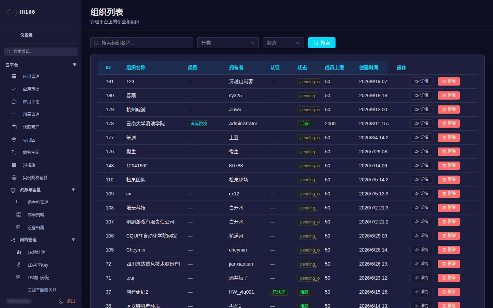
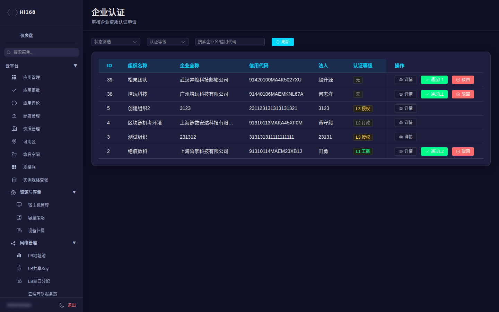
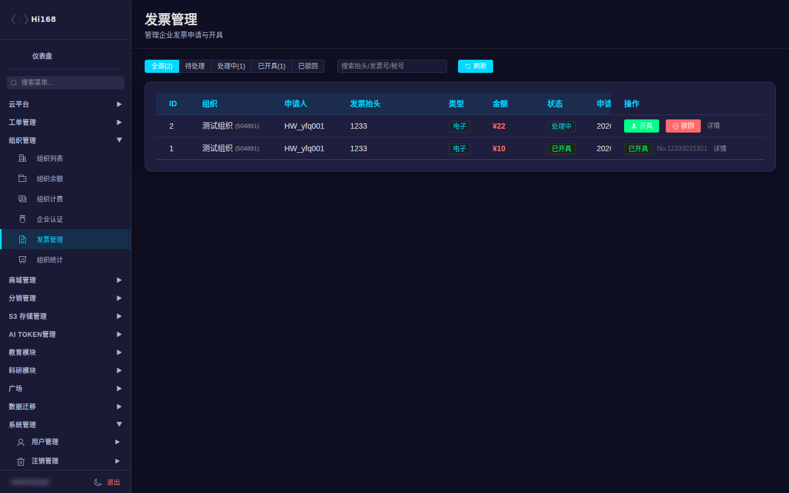

# 组织管理

组织管理用于审核企业/团队、查看组织余额与计费、处理发票和统计。组织是「多人共享资源」的载体，和普通个人账号走不同的入口。

## 一、菜单总览

| 页面 | 用途 |
| --- | --- |
| 组织列表 | 查看组织基本信息、成员、状态 |
| 组织余额 | 组织账户余额与变动 |
| 组织计费 | 组织资源消费与账单 |
| 企业认证 | 审核企业认证材料 |
| 发票管理 | 处理组织开票申请 |
| 组织统计 | 组织数量、活跃、消费等汇总 |

## 二、组织列表

| 字段 | 说明 |
| --- | --- |
| 组织名称 / 类型 | 企业、团队等 |
| 拥有者 | 组织创建人/负责人 |
| 成员数 | 当前成员数量 |
| 认证状态 | 未认证 / 审核中 / 已认证 / 驳回 |
| 状态 | 正常 / 停用等 |
| 创建时间 | 组织创建时间 |

常用操作：

1. 搜索组织名称或拥有者。
2. 点「详情」查看成员、资源、模块与应用。
3. 组织异常时先看认证状态和拥有者账号状态。

> 组织入口不是所有账号可见：用户需要先创建/加入组织并通过认证，之后从「切换账户」进入企业空间。

## 三、企业认证

| 操作 | 说明 |
| --- | --- |
| 查看材料 | 企业名称、统一社会信用代码、营业执照等 |
| 通过 | 认证状态变为已认证，组织可使用对应能力 |
| 驳回 | 必须填写原因，用户可补充后重新提交 |

审核要点：

- 企业名称与营业执照一致。
- 统一社会信用代码格式正确、未重复注册。
- 材料清晰、在有效期内。
- 高风险行业/名称先和商务确认。

## 四、组织余额与计费

| 页面 | 说明 |
| --- | --- |
| 组织余额 | 当前余额、冻结金额、最近变动；可查看余额流水 |
| 组织计费 | 资源消费、账单周期、计费项汇总 |
| 组织统计 | 组织数量、认证率、活跃组织、消费趋势 |

> 余额调整、退款、开票属于财务敏感操作；操作前确认组织、金额、原因，并保留审批记录。

## 五、发票管理

| 字段/操作 | 说明 |
| --- | --- |
| 发票抬头 | 企业名称、税号、地址电话、开户行账号 |
| 金额 / 类型 | 开票金额、普通/专用发票 |
| 申请时间 / 状态 | 待处理 / 已开票 / 驳回 |
| 处理 | 上传发票、填写快递/电子发票信息、驳回原因 |

处理流程建议：

1. 核对抬头、税号与认证信息。
2. 核对可开票金额（已消费、未开票部分）。
3. 开具后回填发票号/文件，状态改为已开票。
4. 驳回必须写明原因并通知申请人。

## 六、常见问题

| 现象 | 处理 |
| --- | --- |
| 用户看不到「组织管理」入口 | 确认已加入组织并通过认证；普通个人账号无入口 |
| 认证一直审核中 | 检查是否有待审材料；材料不全时驳回并说明 |
| 组织余额与个人余额不一致 | 组织与个人是两套账户，切换账户后查看 |
| 开票金额为 0 | 确认该组织有已消费且未开票的订单 |
