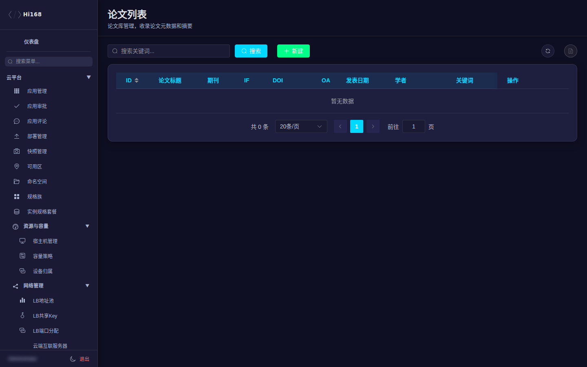

# 科研模块

科研模块维护学术资源目录：领域、期刊、学者、论文、关键词、知识库与订阅关系。

## 一、菜单总览

| 分组 | 页面 | 说明 |
| --- | --- | --- |
| 基础目录 | 科研领域、研究方向 | 学科/方向分类 |
| 期刊与学者 | 期刊管理、学者管理 | 期刊、学者档案 |
| 文献 | 论文管理、关键词管理、相关文献、参考文献 | 论文与引用关系 |
| 知识库 | 知识库管理、文件夹管理、文件管理、附件管理 | 个人/团队知识库 |
| 订阅与关注 | 领域订阅、期刊订阅、学者订阅、关键词订阅、学者关注 | 用户订阅关系 |

## 二、论文管理

| 字段 | 说明 |
| --- | --- |
| 论文标题 | 必填 |
| 期刊 | 所属期刊 |
| IF / DOI / OA | 影响因子、DOI、开放获取标记 |
| 发表日期 | 发表时间 |
| 学者 / 关键词 / 研究方向 | 多选关联 |
| 链接 / 摘要 | 原文链接与摘要 |

> 论文与学者、关键词是多对多关系；导入前先去重（DOI/标题），避免重复条目。

## 三、期刊与学者

| 页面 | 关键字段 |
| --- | --- |
| 期刊管理 | 期刊名称、ISSN、分区、影响因子、出版社 |
| 学者管理 | 姓名、机构、研究方向、主页、ORCID |
| 科研领域 / 研究方向 | 名称、层级、排序 |

> 学者/期刊是论文检索的基础数据，命名尽量统一，避免同人多名、同刊多名。

## 四、关键词与文献关系

| 页面 | 说明 |
| --- | --- |
| 关键词管理 | 关键词词典 |
| 相关文献 | 论文之间的相关关系 |
| 参考文献 | 论文引用关系 |
| 附件管理 | 论文/知识库附件 |

## 五、知识库

| 页面 | 说明 |
| --- | --- |
| 知识库管理 | 知识库名称、归属、权限 |
| 文件夹管理 | 知识库内目录树 |
| 文件管理 | 文件元数据与存储位置 |
| 附件管理 | 上传附件与下载 |

> 删除知识库前确认成员与文件；文件较大时优先用对象存储，不要放容器本地盘。

## 六、订阅与关注

领域/期刊/学者/关键词订阅和学者关注用于前台「我的订阅」。排查「用户收不到更新」时，先确认订阅记录存在、对象状态正常、通知任务是否执行。

## 七、常见问题

| 现象 | 处理 |
| --- | --- |
| 论文重复 | 按 DOI/标题去重，合并作者与关键词 |
| 学者信息不全 | 补机构、方向、主页；关联论文 |
| 期刊检索不到 | 检查名称、ISSN、状态 |
| 知识库文件丢失 | 文件记录 + 对象存储路径 + 桶状态 |
| 订阅无更新 | 订阅记录、对象是否有新内容、通知任务 |
