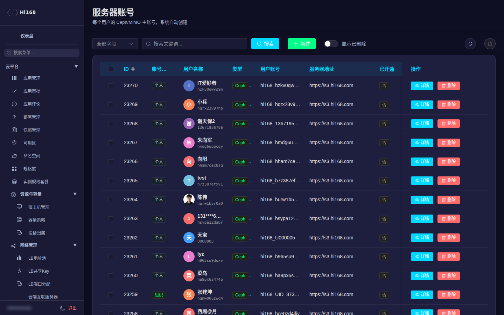
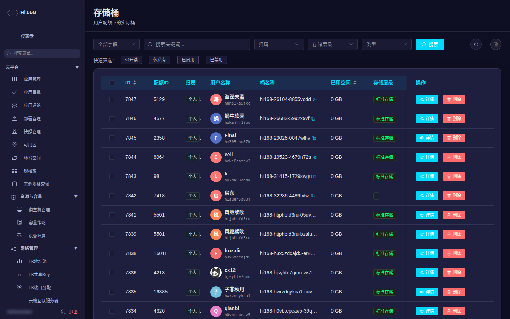
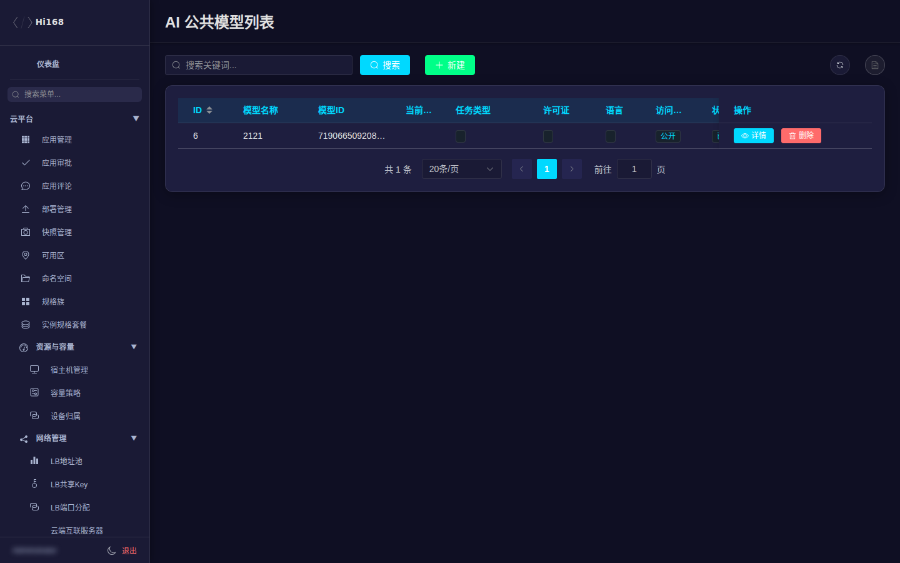

# S3 存储与 AI 模型

「S3 存储管理」覆盖对象存储账号、配额、桶、流量、计费与共享；「AI 模型数据集」也挂在这个分组下，用于维护模型/数据集的公共目录。

## 一、菜单总览

| 分组 | 页面 | 用途 |
| --- | --- | --- |
| 账号管理 | 服务器账号 / 子账号 | S3 服务端账号与租户子账号 |
| 配额与资源 | 用户配额 / 存储桶 / 容量调整 | 容量与桶资源 |
| 流量与速率 | 流量包明细 / 速率规则 / 流量日志 / 违规处罚 | 流量与限速 |
| 计费与权益 | 用量计费 / 权益记录 / 订单配额 | 存储计费 |
| 其他 | 分享链接 / 异步任务 / 同步队列 | 运维任务 |
| AI 模型数据集 | 公共/私有模型、公共/私有数据集、生成类型、标签、框架、格式、版本、评论、导入任务 | AI 资源目录 |
| 系统配置 | S3 系统配置 | 存储服务的全局参数 |

## 二、账号管理

| 页面 | 说明 |
| --- | --- |
| 服务器账号 | S3 集群/服务端账号、接入信息、状态 |
| 子账号 | 租户子账号、AccessKey、所属用户/组织、状态 |

> AccessKey 属于敏感信息；截图、工单、聊天中不要明文传递。需要轮换时先确认业务侧改配时间。

## 三、配额与资源

| 字段 | 说明 |
| --- | --- |
| 配额ID / 用户 | 桶所属配额与用户 |
| 归属 | 个人 / 组织 |
| 桶名称 / 自定义名称 | S3 桶标识与前台展示名 |
| 已用空间 | 当前用量 |
| 存储层级 | 标准 / 低频 / 冷 / 归档 |
| 类型 | 通用 / AI数据集 / AI模型 |
| 公开读 | 是否允许匿名读（谨慎开启） |
| 桌面快捷 | 是否在用户桌面显示 |
| 启用 | 是否可用 |
| 计量字段 | 计费次数、上次计量/用量/计费 |

| 页面 | 说明 |
| --- | --- |
| 用户配额 | 每个用户/组织的容量上限 |
| 容量调整 | 扩容/缩容记录 |

> 删除桶前必须确认没有业务引用；建议先停写、备份、再删除。公开读会带来数据泄露风险。

## 四、流量与速率

| 页面 | 说明 |
| --- | --- |
| 流量包明细 | 用户购买的流量包与剩余量 |
| 速率规则(应用层) | 按应用/用户的下行限速 |
| 流量日志 | 流量使用与异常记录 |
| 违规处罚 | 超限/违规的处罚记录 |

> 限速/处罚会影响用户体验；调整前先看流量日志确认是持续超限还是瞬时峰值。

## 五、计费与权益

| 页面 | 说明 |
| --- | --- |
| 用量计费 | 按量计费明细 |
| 权益记录 | 存储权益发放与使用 |
| 订单配额 | 购买配额与订单关系 |

## 六、其他运维

| 页面 | 说明 |
| --- | --- |
| 分享链接 | 用户生成的分享链接与有效期 |
| 异步任务 | 后台异步任务状态 |
| 同步队列 | 跨集群/跨区域同步队列 |

> 清理分享链接前确认接收方是否仍在使用；异步任务失败先看错误信息再重试。

## 七、AI 模型与数据集

| 页面 | 说明 |
| --- | --- |
| 公共模型 / 私有模型 | 模型目录；公共模型面向所有用户，私有模型归属用户/组织 |
| 公共数据集 / 私有数据集 | 数据集目录 |
| 生成类型 / 研究领域标签 / 应用领域标签 | 分类与检索标签 |
| 模型框架 / 模型格式 | PyTorch、TensorFlow、GGUF 等 |
| 模型版本 / 数据集版本 | 版本与文件信息 |
| 模型评论 / 数据集评论 | 评论审核 |
| 导入任务 | 外部模型/数据集导入进度与错误 |

> 模型文件通常较大，导入任务失败优先看存储路径、配额和网络；上线公共模型前确认授权与合规。

## 八、S3 系统配置

用于配置存储服务的全局参数（端点、区域、默认配额等）。修改前先记录原值，变更后验证上传/下载与计费是否正常。

## 九、常见问题

| 现象 | 排查 |
| --- | --- |
| 用户上传失败 | 配额是否用尽、桶是否启用、速率规则是否限流、AccessKey 是否有效 |
| 用量与账单不一致 | 看计量时间、存储层级、流量包抵扣顺序 |
| 桶无法访问 | 公开读/权限策略、桶状态、子账号权限 |
| 模型导入失败 | 导入任务错误、文件大小/格式、目标桶配额 |
| 分享链接失效 | 有效期、是否被手动清理、桶是否可读 |
