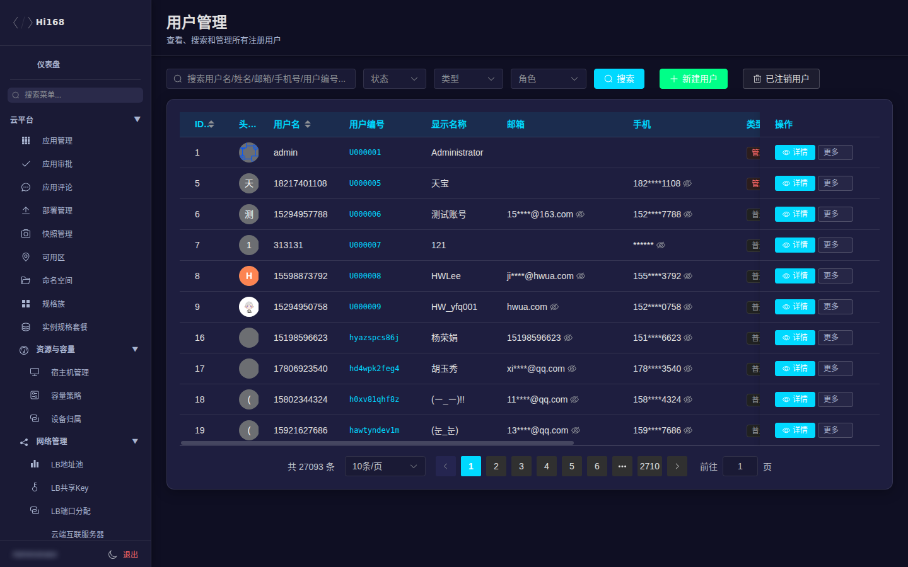
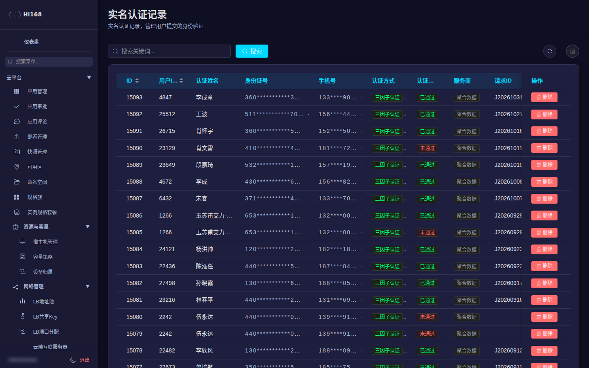
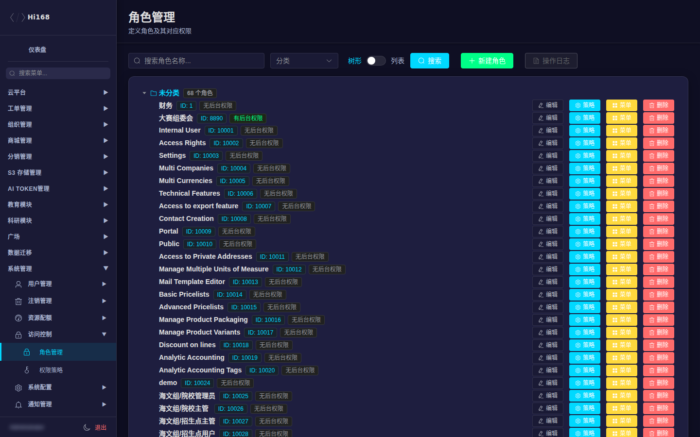
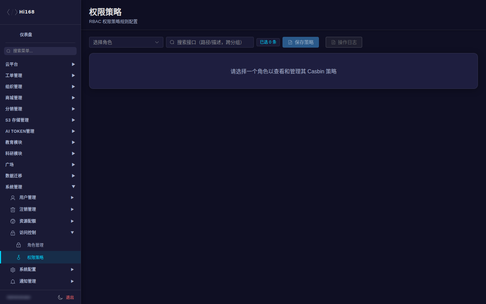
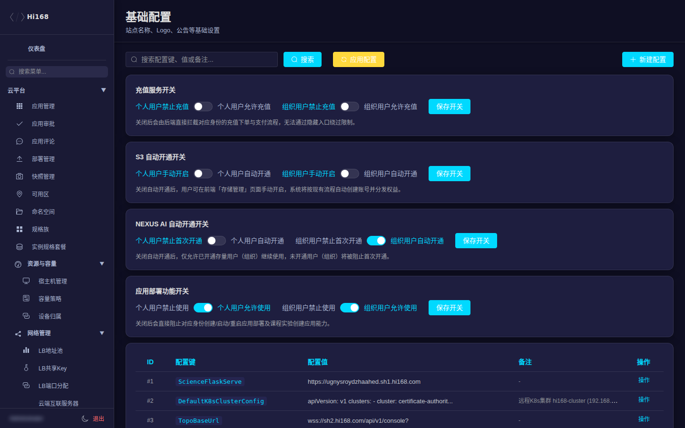
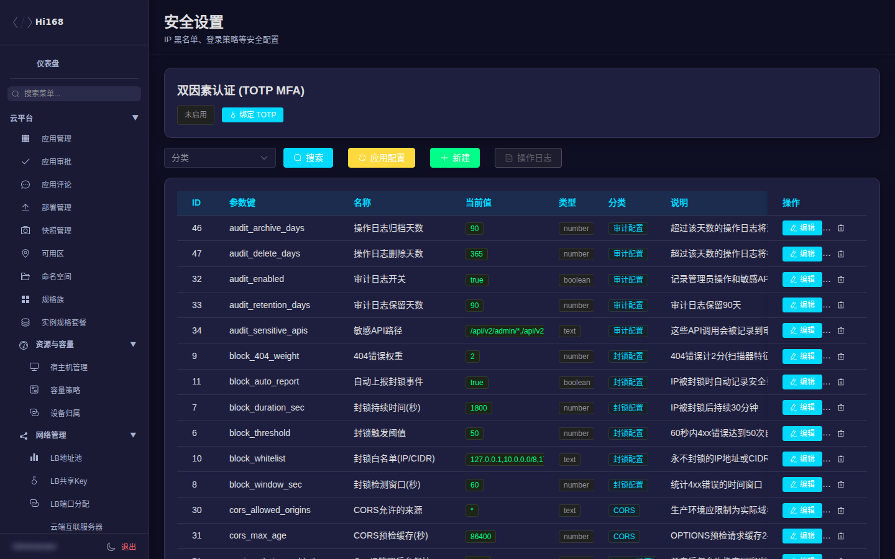
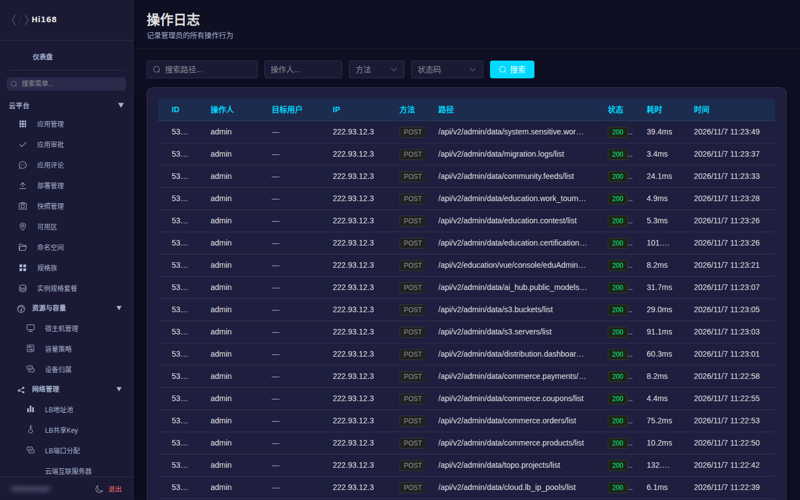
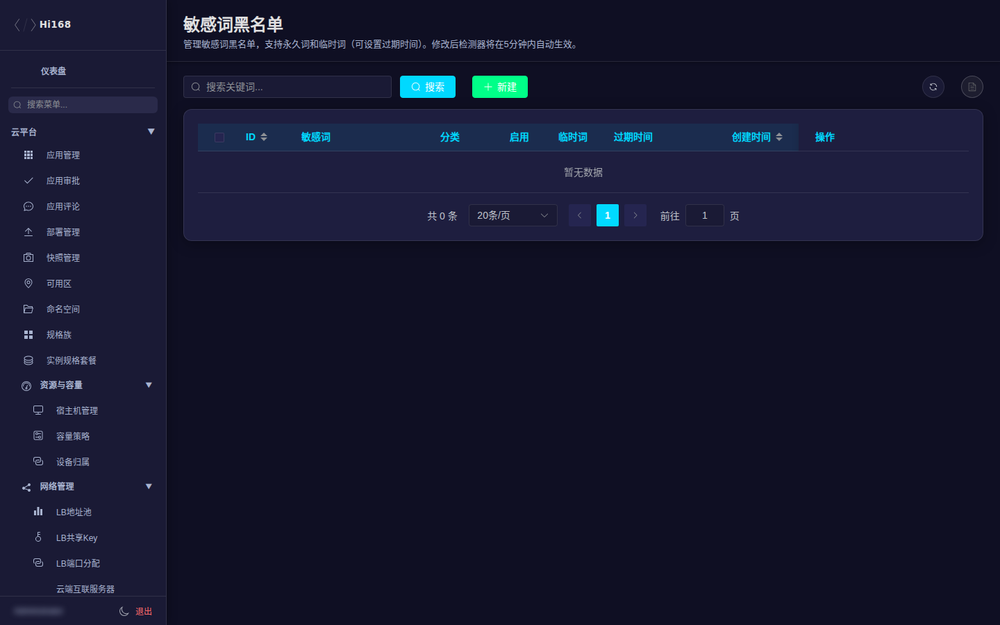

# 系统管理

系统管理是后台的「总控台」：用户、注销、配额、角色与权限、系统配置、通知、安全、站内通知、敏感词和权益。多数高风险操作都在这里。

## 一、菜单总览

| 分组 | 页面 |
| --- | --- |
| 用户管理 | 用户列表、预用户列表、实名认证记录、封禁记录、用户徽章、徽章目录 |
| 注销管理 | 注销工单、注销审计日志、防薅指纹 |
| 资源配额 | 角色资源限制、用户配额管理 |
| 访问控制 | 角色管理、权限策略 |
| 系统配置 | 基础配置、分类管理、API 管理、模块管理、定时任务、AI 配置、信息展示 |
| 通知管理 | 短信模板、邮件模板、邮箱账号池、短信记录、邮件记录、消息配置 |
| 安全管理 | 安全事件、安全设置、操作日志 |
| 站内通知 | 发送通知、发送记录、通知记录、通知模板 |
| 敏感词管理 | 敏感词黑名单、敏感词白名单 |
| 权益配置 | 权益项配置、发放记录 |

## 二、用户管理

### 2.1 用户列表

| 字段/按钮 | 说明 |
| --- | --- |
| ID / 用户名 / 显示名 | 用户标识 |
| 手机 / 邮箱 | 联系方式（截图已模糊） |
| 用户类型 / 角色 | 普通用户、管理员、教师等 |
| 状态 | 正常/禁用/注销 |
| 注册时间 / 最后登录 | 账号活跃信息 |
| 详情 / 编辑 / 更多 | 查看资料、改角色、重置密码、踢出设备等 |

常见操作：

1. 搜索用户名/手机号/邮箱。
2. 进入详情查看角色、登录日志、操作记录、在线设备。
3. 改角色前确认目标角色有对应后台/业务权限。
4. 重置密码、踢出设备、封禁属于敏感操作，先核实身份与工单。

> 用户列表包含个人信息，截图/导出后注意脱敏；不要在生产批量导出全量用户。

### 2.2 预用户与实名认证

- **预用户列表**：批量开通/待激活账号；导入前确认模板字段与重复账号。
- **实名认证记录**：查看/审核实名材料；驳回需写原因。

### 2.3 封禁、徽章

| 页面 | 说明 |
| --- | --- |
| 封禁记录 | 封禁原因、期限、解封；可同步 S3/Ceph 状态 |
| 用户徽章 | 用户已获得的徽章 |
| 徽章目录 | 徽章定义、图标、发放规则 |

> 封禁前确认违规证据；解封/同步失败时先看封禁记录与 S3 状态是否一致。

## 三、注销管理

| 页面 | 说明 |
| --- | --- |
| 注销工单 | 用户注销申请、冷静期、处理状态 |
| 注销审计日志 | 注销操作审计 |
| 防薅指纹 | 识别反复注册/注销的设备/账号特征 |

> 注销涉及数据保留与合规；按流程处理，不要手工删除用户主记录。

## 四、资源配额

| 页面 | 说明 |
| --- | --- |
| 角色资源限制 | 按角色限制资源数量/规格 |
| 用户配额管理 | 单用户配额覆盖 |

## 五、访问控制

### 5.1 角色管理

角色是权限的载体。每个角色有：

- **策略**：接口权限（Casbin），决定能调用哪些后台接口。
- **菜单**：左侧栏可见菜单（`authority_menu_keys`）。

### 5.2 权限策略

进入「角色管理」点某个角色的 **策略**，或打开「权限策略」页选择角色，即可勾选接口。保存是「读取现有 → 合并 → 提交」，不要用「全选/清空」误伤已有权限。

> 本教程的访问权限也在这一页配置，完整步骤见 [权限与访问入口](./access-control)。

### 5.3 菜单权限

「角色管理 → 菜单」控制左侧栏显示。注意：

- 菜单可见 ≠ 接口可用；两者要一起配。
- 一旦显式分配菜单 Key，该角色只显示这批 Key；需要把所有要用的菜单一起勾上。
- 不建议用「前缀匹配」思维手动猜 Key，按菜单树勾选。

## 六、系统配置

| 页面 | 说明 |
| --- | --- |
| 基础配置 | 站点名称、公告、注册开关、默认参数等 |
| 分类管理 | 业务分类字典 |
| API 管理 | 后台接口目录（权限策略页的勾选项来源） |
| 模块管理 | 业务模块启停/菜单开关 |
| 定时任务 | 后台定时任务与执行记录 |
| AI 配置 | AI 相关参数（注意环境变量可能覆盖 DB） |
| 信息展示 | 前台展示配置 |

> 基础配置影响全站；修改前记录原值，改后验证前台与后台。部分配置只在进程启动时加载，改 DB 可能需要重启服务。

## 七、通知管理

| 页面 | 说明 |
| --- | --- |
| 短信模板 / 邮件模板 | 模板内容与变量 |
| 邮箱账号池 | 发件邮箱池 |
| 短信记录 / 邮件记录 | 发送结果与失败原因 |
| 消息配置 | 通道开关、限流、默认模板 |

> 模板变量必须与业务参数一致；发送失败先看记录中的通道返回码。

## 八、安全管理

| 页面 | 说明 |
| --- | --- |
| 安全事件 | 登录异常、封禁、风控事件 |
| 安全设置 | MFA、IP 黑名单、地区限制、会话策略 |
| 操作日志 | 后台操作审计（谁在什么时间改了什么） |

> 安全设置变更可能立即影响所有管理员登录；变更前确认自己有备用登录方式。

## 九、站内通知

| 页面 | 说明 |
| --- | --- |
| 发送通知 | 选择用户/群体、模板、发送时间 |
| 发送记录 | 发送结果 |
| 通知记录 | 用户已读/未读 |
| 通知模板 | 站内信模板 |

> 群发前先用测试账号预览；确认目标人群，避免误发。

## 十、敏感词管理

| 页面 | 说明 |
| --- | --- |
| 敏感词黑名单 | 命中后拦截/替换/审核 |
| 敏感词白名单 | 排除误判词 |

> 生产网关是否连接 DB 会影响敏感词生效范围；修改后验证实际拦截效果，不要只看后台保存成功。

## 十一、权益配置

| 页面 | 说明 |
| --- | --- |
| 权益项配置 | 权益定义、有效期、适用对象 |
| 发放记录 | 权益发放流水 |

## 十二、常见问题

| 现象 | 排查 |
| --- | --- |
| 用户能进后台但看不到菜单 | 菜单权限未配；或显式分配后漏勾其它菜单 |
| 能看到菜单但接口 403 | 缺少对应 Casbin 策略 |
| 改了配置前台不生效 | 缓存/进程启动时加载/需要重启服务 |
| 管理员被锁在后台外 | 用 888 超管恢复；检查角色策略与安全设置 |
| 敏感词不生效 | 网关 DB 连接、黑白名单优先级、缓存刷新 |
| 操作日志查不到 | 时间范围、操作人、接口路径筛选；审计异步写入可能有延迟 |
