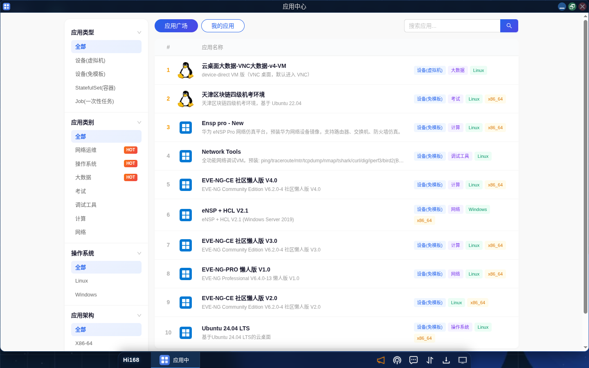
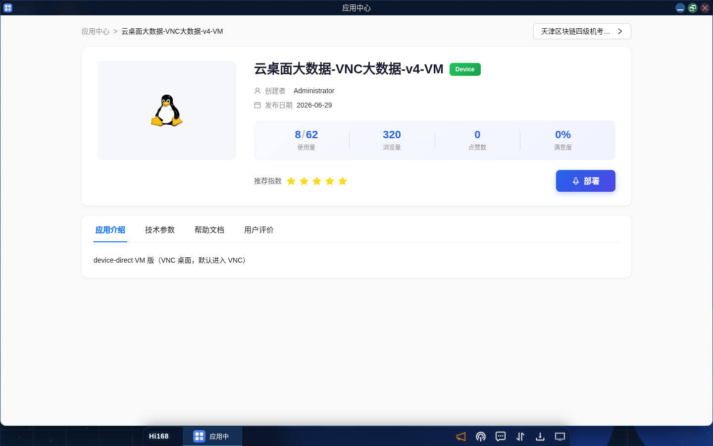
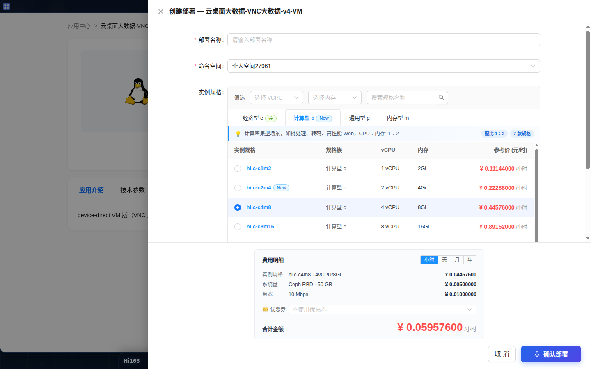
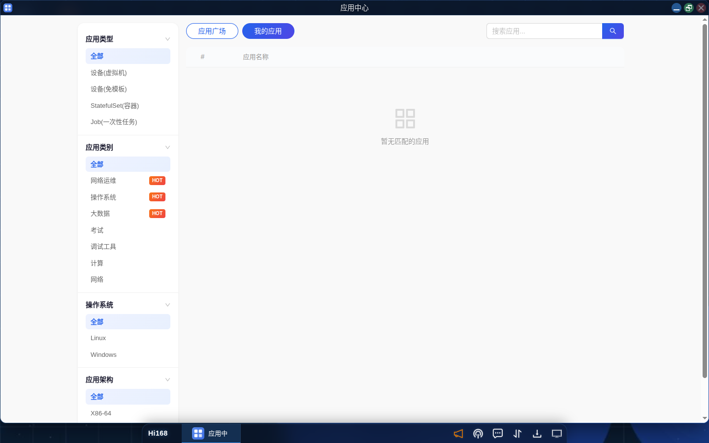

# 应用服务

## 概述

Hi168 平台的 **应用服务** 模块是用户使用平台的核心入口，涵盖应用的浏览、部署、运行及全生命周期管理。平台提供丰富的预置应用模板，覆盖网络安全、人工智能、大数据、开发运维、操作系统等多个领域，用户可一键部署所需的实验或工作环境，并通过「我的应用」对已部署的实例进行统一管理。

> 本章包含：应用中心 → 应用详情 → 部署 → 我的应用 → 快照/模板 → 常见问题。

---

## 一、入口与界面

登录后进入 **云桌面中心**，应用相关入口有两处：

| 入口 | 路径 | 说明 |
| --- | --- | --- |
| 桌面图标 | 桌面第一列「应用中心」 | 双击/单击图标打开应用中心窗口 |
| 启动菜单 | 桌面左下角 **Hi168** 按钮 → 「应用中心」 | 首次使用需先安装，安装后图标出现在桌面 |

> **提示**：应用窗口之间相互独立，可拖动、缩放、最小化；点击窗口右上角的「最大化」按钮可获得更大的操作区域。

---

## 二、应用中心

### 2.1 界面说明

应用中心以「应用广场 / 我的应用」两个标签页组织内容。**应用广场** 展示平台所有可部署的应用模板，左侧为筛选栏，右侧为应用列表。

### 2.2 筛选维度

左侧筛选栏提供四个维度，选择后列表实时过滤：

| 维度 | 当前取值 | 说明 |
| --- | --- | --- |
| **应用类型** | 全部、设备(虚拟机)、设备(免模板)、StatefulSet(容器)、Job(一次性任务) | 「设备(虚拟机)」为完整虚拟机；「设备(免模板)」无需模板即可创建；「StatefulSet(容器)」为容器工作负载；「Job(一次性任务)」执行完即退出 |
| **应用类别** | 全部、网络运维、操作系统、大数据、考试、调试工具、计算、网络 等 | 按使用场景分类，部分类别带 **HOT** 标记 |
| **操作系统** | 全部、Linux、Windows | 应用内运行的操作系统 |
| **应用架构** | 全部、X86-64、ARM64 | 应用镜像的 CPU 架构 |

列表列包含：序号、应用名称、描述、应用类型、应用类别、操作系统、架构、版本、作者、收藏数、部署数。右上角搜索框支持按应用名称模糊检索。

### 2.3 应用详情

点击应用名称进入详情页。详情页顶部为应用名称、描述、状态与价格，右上角为 **部署** 按钮；下方提供四个标签页：

| 标签页 | 说明 |
| --- | --- |
| **应用介绍** | 应用封面、软件介绍、截图 |
| **技术参数** | 应用 ID、版本、架构、所属类别、接触电话/联系人、占用资源、访问方式、版本次数、授权限制、下载次数、发布时间、更新时间 |
| **帮助文档** | 应用的使用说明 |
| **用户评价** | 用户的评分与评论（可按「最有帮助」「最新」「高评分」排序） |

### 2.4 部署应用

点击详情页右上角 **部署**，弹出「部署应用」对话框：

1. **首次部署方式**：选择「单机部署」或「主从部署」。
2. **计费方式**：选择「按量计费」或「包年包月」。按量计费按小时结算；包年包月一次性支付固定周期费用。
3. **应用名称**：默认为应用名，可修改；系统会自动追加实例编号（如 `-1nz3id`）。
4. **命名空间**：选择应用所属的命名空间（默认个人空间）。
5. **配置资源**：CPU 核数、内存、系统盘、带宽，右侧实时显示单价（元/小时）。
6. **优惠券**（可选）：选择可用优惠券抵扣。
7. 核对「合计金额」后点击 **确认部署**。

> **计费提示**：部署成功后按小时持续扣费；停机后仍会按存储占用收取少量费用，彻底删除应用后停止计费。详见 [计费规则](./appendix.md)。

> **注意**：部署会创建真实计算资源。实验结束后请及时删除不再使用的应用，避免余额持续消耗。

---

## 三、我的应用

### 3.1 应用列表

在应用中心切换到 **我的应用** 标签页，可查看当前账号已部署的应用。列表包含：序号、应用名称、状态、实例数、创建时间、到期时间、操作。

> 若列表为空，说明当前账号还没有部署任何应用，可在「应用广场」选择应用部署。

### 3.2 应用详情

点击应用名称进入应用详情，可查看：

- **应用概览**：应用 ID、名称、模板名称、运行状态、创建时间、到期时间、命名空间、资源配额、余额消耗、应用描述。
- **环境列表**：该应用关联的环境实例。
- **快照列表**：已创建的快照记录。

应用名称、环境名称和资源配额支持在详情页直接修改。

### 3.3 修改配额

应用运行过程中如发现 CPU / 内存不足，可在详情页点击 **修改配额**，提升资源配置。修改后按新规格计费。

### 3.4 创建快照

快照用于保存应用当前的状态与数据，便于回滚或制作模板。

| 操作 | 说明 |
| --- | --- |
| **创建快照** | 按当前环境状态生成快照，加入快照列表 |
| **删除快照** | 删除指定快照 |
| **回滚快照** | 将应用恢复到快照记录的状态 |
| **基于快照创建模板** | 以快照为基础制作应用模板，供后续复用 |

### 3.5 创建模板

将当前应用的状态和配置保存为模板：

1. 在应用概览页点击 **创建模板**。
2. 填写模板名称（必填）。
3. 上传模板展示图片（可选）。
4. 填写模板介绍（必填）。
5. 选择 **支持 ttyd**、**支持 webshell**（不变 / 是 / 否）。
6. 点击 **确定** 开始制作。

> 制作耗时取决于镜像修改内容，可能从数秒到数分钟；完成后可在「应用模板」中查看。

### 3.6 删除应用

两种方式：

- 在应用概览详情页执行删除；
- 在桌面上右击应用图标，选择「删除」。

> **⚠️ 删除不可恢复**。删除前请确认重要数据已通过快照或存储桶备份。

---

## 四、应用操作界面

应用启动后会打开独立窗口。不同应用提供的功能菜单略有差异，常见菜单如下：

### 4.1 容器应用

| 功能 | 说明 |
| --- | --- |
| **HTTP Web 服务** | 以浏览器打开指定端口的 Web 服务，需先在「服务端口」中配置 |
| **命令行终端** | Linux Shell 终端 |
| **服务端口** | 管理端口暴露，支持 HTTP、TCP、UDP、TTYD、WEBSHELL 五种类型 |
| **挂载存储桶** | 将已有存储桶挂载到应用内，实现持久化与跨应用共享 |
| **文件系统** | 图形化文件管理器，支持上传、下载 |
| **刷新** | 刷新应用界面 |
| **应用快照** | 为当前状态创建快照 |

### 4.2 虚拟机应用

在容器应用菜单基础上增加：

| 功能 | 说明 |
| --- | --- |
| **图形化终端** | 通过 VNC 连接虚拟机桌面 |
| **文件上传下载** | 通过 `trz`（上传）/ `tsz`（下载）传输文件 |
| **控制面板** | noVNC 控制面板，支持剪贴板等辅助功能 |
| **自动调整界面比例** | 自适应调整图形桌面比例 |

> **提示**：容器型应用与虚拟机应用的菜单并非完全一致，以实际窗口顶部工具栏为准。

---

## 五、最佳实践

1. **部署前确认规格**：按实际需求选择 CPU、内存与系统盘，避免资源浪费。
2. **定期快照**：进行关键实验前创建快照，确保可回退。
3. **善用模板**：配置好的环境保存为模板，后续一键复用。
4. **关注余额**：应用运行期间持续扣费，不使用时及时删除。
5. **命名空间隔离**：不同项目使用不同命名空间，便于管理资源。

---

## 六、常见问题

| 问题 | 解决办法 |
| --- | --- |
| 部署后一直处于初始化状态 | 首次部署需要拉取镜像并创建资源，通常 1~5 分钟；超过 10 分钟未就绪请提交工单 |
| 部署按钮不可点击 | 余额不足或当前命名空间资源配额已满；请充值或先释放资源 |
| 「我的应用」列表为空 | 当前账号尚未部署应用；或应用已被删除 |
| 修改配额后费用如何计算 | 按修改后的新规格计费，从变更生效时开始 |
| 删除应用后数据还在吗 | 不在。删除会释放计算与存储资源，请先用快照或存储桶备份 |
| 应用窗口打不开 | 检查浏览器是否拦截弹窗；尝试刷新页面或重新登录 |