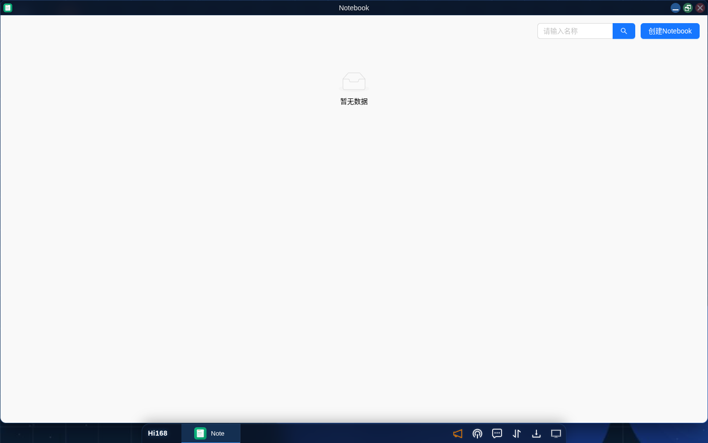
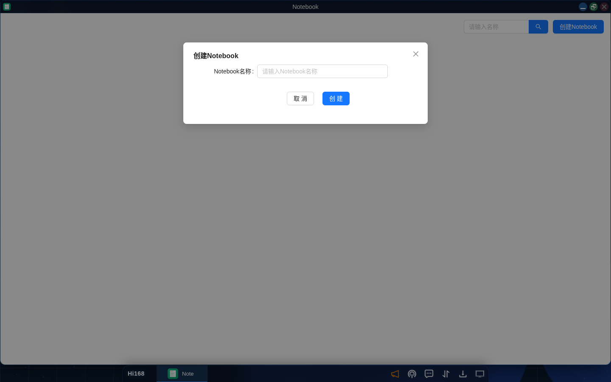

# Notebook

## 概述

Hi168 平台的 **Notebook** 模块提供基于 Web 的交互式编程环境：在浏览器中编写 Python 代码、运行数据分析、绘制图表、编写 Markdown 说明，代码、文字和运行结果保存在同一篇笔记中。

每本 Notebook 拥有**独立的 Jupyter 运行环境（Pod）**，采用「按需启动、空闲回收」的方式：

| 特性 | 说明 |
| --- | --- |
| **独立环境** | 一本笔记对应一个 Jupyter 运行环境，不同笔记之间互不影响 |
| **按需启动** | 打开笔记（本人）或点「运行」时才启动环境，通常等待 10~30 秒 |
| **空闲回收** | 环境空闲 30 分钟后自动回收，暂停计费；再次运行会自动重建 |
| **内容持久** | 笔记正文与单元格保存在平台，环境回收不会丢失笔记内容 |
| **浏览器内使用** | 无需安装 Jupyter，平台不对外暴露 Jupyter 地址和访问令牌 |

常见用途包括：课程实验与数据分析、数据可视化与报告、机器学习入门（scikit-learn / statsmodels）、教学演示与代码分享等。

> **重要**：新建笔记只得到「内容容器」，不会自动产生计算环境。第一次使用请按下文「二、第一次使用」依次完成 **设置应用模板 → 创建应用 → 运行**。

---

## 一、入口与界面

| 入口 | 路径 |
| --- | --- |
| 启动菜单 | 桌面左下角 **Hi168** →「Notebook」 |
| 控制台 | 控制台 → 左侧「Notebook」 |
| 桌面图标 | 安装后单击打开 |



列表页包含：

| 区域 | 说明 |
| --- | --- |
| **搜索框** | 输入名称关键字后回车，按笔记名称筛选 |
| **创建Notebook** | 右上角蓝色按钮，新建一本笔记 |
| **笔记卡片** | 展示笔记名称、作者、发布时间，以及「公开 / 未公开」标识；点击卡片进入详情 |

进入笔记详情后，顶部工具栏从左到右依次为：

| 图标 / 按钮 | 作用 |
| --- | --- |
| **公开 / 未公开** | 当前笔记的可见范围标识 |
| **修改Notebook**（铅笔） | 修改笔记名称、切换公开范围 |
| **添加标签**（标签） | 为笔记添加标签，最多 10 个 |
| **下载Notebook**（云下载） | 下载 `.ipynb` 文件 |
| **上传Notebook**（云上传） | 上传 `.ipynb` 文件（会覆盖当前笔记内容） |
| **删除Notebook**（垃圾桶） | 删除笔记并清理关联运行环境 |
| **设置应用模板**（⊕） | 为笔记选择应用模板 |
| **创建应用**（▷） | 选好模板后出现，用于创建 Jupyter 应用 |
| **状态徽标** | 显示「环境启动中 / 应用已就绪 / 环境已回收 / 环境异常」 |
| **运行**（蓝色按钮） | 环境就绪或已回收时出现，运行笔记中的全部代码 |

---

## 二、第一次使用：创建笔记并启动 Jupyter

> 这是最容易卡住的一步。请严格按以下顺序操作：**先选模板，再创建应用，最后运行**。

### 2.1 新建笔记

1. 进入 **Notebook** 列表；
2. 点击右上角 **创建Notebook**；
3. 填写 **Notebook名称**（例如 `data-analysis-01`）；
4. 点击 **创建**。



> 此时只创建了笔记内容容器，**没有计算环境，也不会计费**。页面会提示「还没有内容，先添加一个段落开始写作」，可以立即开始编写代码或文字。

### 2.2 设置应用模板

1. 进入刚创建的笔记详情页；
2. 点击右上角的 **⊕（设置应用模板）**；
3. 在弹窗「添加应用」中，**模板类型**选择 **官方模板**；
4. 在模板下拉框中选择 **`Jupyter Notebook`**；
5. 点击 **确定**。

> 选好模板后，⊕ 旁边才会出现 **▷（创建应用）**。如果没有出现 ▷，说明模板尚未选中，请重新选择。

### 2.3 创建应用

1. 点击 **▷（创建应用）**；
2. 在弹窗中填写 **应用名称**（3~50 个字符，可自定义）；
3. **空间类型 / 命名空间**保持默认即可；
4. **部署方式**按页面默认；
5. 点击 **确定**。

创建完成后，应用处于 **「环境已回收，点「运行」会自动重新启动」**（未启动）状态，这是正常状态：

- 创建应用本身只登记运行配置，**不会立刻启动计算环境，也不会因创建应用而计费**；
- 如果你仍停留在详情页，平台随后会自动预热，状态进入「环境启动中」；
- 如果离开页面，环境保持「环境已回收」，下次打开笔记或点「运行」时再启动。

### 2.4 启动并运行

1. 保持在本人的笔记详情页，平台会自动预热环境；
2. 等待状态变为 **「环境启动中（约 10~30 秒）…」**，再变为 **「应用已就绪，可以运行Notebook代码」**；
3. 右上角出现蓝色 **运行** 按钮，代码单元格旁也会出现单格运行图标；
4. 点击 **运行** 执行全部代码，或点击单元格的运行图标执行单个单元格；
5. 运行结果显示在单元格下方的 **Out** 区域（文本、图片、报错信息均可显示）。

> 第一次启动需要拉取镜像和初始化 Python 环境，通常需要十几秒到半分钟。镜像已预热时启动会更快。

### 2.5 常见卡点

| 现象 | 原因 | 处理 |
| --- | --- | --- |
| 没有 **▷（创建应用）** | 还没有选择应用模板 | 先点 ⊕ 选择 **官方模板 → `Jupyter Notebook`** |
| 有 ▷，但创建后仍不能运行 | 应用刚创建，环境尚未启动 | 等待状态变为「应用已就绪」 |
| 没有 **运行** 按钮 | 未选模板、未创建应用，或状态不是「已就绪 / 已回收」 | 按本节顺序检查；详见下文「七、常见问题」 |
| 创建应用弹窗提交后很久没反应 | 平台正在准备应用与访问配置 | 等待；不要重复点击，必要时刷新页面查看状态 |

---

## 三、状态说明

笔记详情页会用状态徽标提示当前环境状态：

| 页面提示 / 表现 | 含义 | 用户该做什么 |
| --- | --- | --- |
| **无状态徽标，显示 ▷** | 未创建：已选模板，但还没有创建应用 | 点 **▷（创建应用）** |
| **弹窗提交中（环境准备）** | 正在提交创建请求、准备应用与访问配置，暂无状态徽标 | 等待；不要重复点击 |
| **环境启动中（约 10~30 秒）…** | 运行环境正在启动，Python 内核尚未就绪 | 等待，通常十几秒到半分钟 |
| **应用已就绪，可以运行Notebook代码** | 环境可用 | 点「运行」或单格运行 |
| **环境已回收，点「运行」会自动重新启动** | 空闲超时后环境已释放，属于正常状态 | 点「运行」会自动重启，等待就绪即可 |
| **应用暂未就绪，不能运行Notebook代码** | 环境启动中或启动异常，暂时不可用 | 稍后刷新；持续不恢复请见常见问题 |
| **环境异常，请删除应用后重新创建** | 域名、鉴权或启动失败，等待无法恢复 | 删除应用后重新创建，或联系平台管理员 |

> 状态为「环境已回收」不是故障。平台会在你再次运行代码时自动重建环境。

---

## 四、编辑与运行

### 4.1 代码与文字单元格

笔记由多个「段落」组成，每个段落可以是 **代码** 或 **Markdown 文本**：

| 操作 | 方法 |
| --- | --- |
| **新建代码** | 鼠标移到任意段落，点击工具栏的代码图标；空笔记可直接点页面中央的「新建代码」 |
| **新建文本** | 鼠标移到任意段落，点击工具栏的文本图标；空笔记可直接点「新建文本」 |
| **编辑文本** | 双击文本段落，或点击工具栏的「编辑」；支持标题、列表、表格、代码块、图片等 Markdown 语法 |
| **保存** | 点击段落工具栏的「保存」图标 |
| **删除段落** | 点击段落工具栏的垃圾桶图标并确认 |
| **调整阅读位置** | 左侧「目录」按文本段落**第一行**的标题生成层级（`#` 为一级、`##` 为二级……），点击可跳转；第一行不是标题的文本不会进入目录 |

> **注意**：平台不会在你每次输入时实时保存。编辑完成后请点击 **保存**；切换段落时，当前正在编辑的文本段落也会自动提交保存。

### 4.2 运行代码

| 操作 | 说明 |
| --- | --- |
| **单格运行** | 环境为「应用已就绪」后，点击代码单元格工具栏的运行图标，仅执行当前单元格 |
| **运行全部** | 点击页面右上角蓝色 **运行** 按钮，按顺序执行所有代码单元格 |
| **查看结果** | 结果显示在单元格下方的 **Out** 区域；报错会显示 traceback |
| **运行状态** | 运行期间按钮显示加载状态，请等待本次运行结束 |

> 环境处于「环境已回收」时，点击右上角 **运行** 会先自动启动环境，再执行代码。单格运行图标需要环境就绪后才会出现。

### 4.3 目录、评论与标签

| 功能 | 说明 |
| --- | --- |
| **目录** | 左侧「目录」标签按文本段落第一行的标题自动生成，支持展开/折叠与点击跳转 |
| **评论** | 每个段落可单独评论；顶部「评论」显示全部评论数量，点击可打开评论面板 |
| **点赞** | 顶部「赞」可为笔记点赞 |
| **标签** | 点击标签图标添加，最多 10 个；可进入删除模式移除标签 |

### 4.4 上传与下载 ipynb

| 操作 | 说明 |
| --- | --- |
| **下载** | 点击云下载图标，将当前笔记下载为 `.ipynb` 文件，可用本地 Jupyter 打开或备份 |
| **上传** | 点击云上传图标并确认，选择 `.ipynb` 文件；**上传会覆盖当前笔记的全部内容** |

> 上传前建议先下载一份当前笔记作为备份。仅支持 `.ipynb` 格式。

### 4.5 公开与分享

点击 **修改Notebook** 可将笔记设为 **公开** 或 **未公开**：

- **公开**：其他用户可以浏览笔记内容、查看评论；
- **未公开**：仅本人可见（平台工作人员按管理权限可查看）。

> 其他用户即使能浏览公开笔记，也**不能运行其中的代码**；运行按钮只对笔记本人或平台工作人员显示。

---

## 五、环境回收与再次运行

平台按「用完即回收」的方式管理 Notebook 资源：

| 规则 | 说明 |
| --- | --- |
| **空闲回收** | 环境空闲 **30 分钟**后自动回收，运行环境被删除，计费暂停 |
| **单次会话上限** | 一次环境启动连续运行最长 **12 小时**，到时强制回收 |
| **再次运行** | 点「运行」会自动重建环境，重新等待启动 |
| **状态重置** | 重建后 Python 内核是全新的：变量、导入的模块、`/tmp` 临时文件、`pip install` 安装的包都会丢失 |
| **内容保留** | 笔记正文、代码、Markdown、评论、标签保存在平台，不会因回收丢失 |

> 回收后再运行发现「之前的变量没了」属于正常现象，不是故障。重新从上到下运行需要的单元格即可。

---

## 六、资源与计费

### 6.1 资源规格

每个 Notebook 运行环境使用固定的资源规格（具体以创建应用页面显示为准）：

| 资源 | 规格 |
| --- | --- |
| **CPU** | 上限 1 核（平台保障 0.5 核） |
| **内存** | 上限 2 GiB（平台保障 1 GiB） |
| **临时存储** | 上限 5 GiB；其中 `/tmp` 可用 2 GiB |
| **运行环境** | Python 3.11，预装 numpy、pandas、scipy、matplotlib、seaborn、scikit-learn、statsmodels、openpyxl 等常用库 |
| **持久化磁盘** | 无。工作目录和 `/tmp` 均为临时空间 |

### 6.2 计费规则

| 阶段 | 是否计费 |
| --- | --- |
| 新建笔记 | 不计费 |
| 选择模板、创建应用（环境未启动） | 不计费 |
| 环境已回收 | 不计费（Notebook 不使用持久化磁盘，不会因存储继续扣费） |
| 环境运行中 | 按页面显示的资源价格计费，从账户余额中扣减 |

> 详细扣费规则见 [附录 · 计费规则](./appendix.md)。实际价格、资源档位以创建应用页面和「费用中心」显示为准。

### 6.3 安装第三方包

环境允许联网，可在代码单元格中执行 `pip install`：

```python
!pip install 包名
```

> 安装的包只在本次环境运行期间有效。环境回收后运行环境被删除，安装的包会一起丢失；下次运行需重新安装。建议把安装命令放在笔记开头，便于重复执行。

---

## 七、常见问题

### 7.1 为什么没有「运行」按钮？

这是最常见的问题。**绝大多数情况是还没有选择应用模板**：新建笔记默认没有绑定模板，页面因此不显示状态徽标、不显示「创建应用」，也不会显示「运行」。

请按以下步骤处理：

1. 点击标题栏右侧的 **⊕（设置应用模板）**；
2. 模板类型选择 **官方模板**；
3. 选择 **`Jupyter Notebook`**；
4. 点击 **确定**；
5. 此时 ⊕ 旁边出现 **▷（创建应用）**，点击它；
6. 填写应用名称、保持默认命名空间，点击 **确定**；
7. 等待状态从「环境启动中」变为「应用已就绪」；
8. 右上角出现蓝色 **运行** 按钮，代码单元格旁出现单格运行图标。

其他可能原因：

| 原因 | 判断方法 | 处理 |
| --- | --- | --- |
| 已选模板但未创建应用 | 状态区域没有徽标，但有 ▷ | 点 ▷ 创建应用 |
| 不是笔记本人 / 平台工作人员 | 看的是别人分享的公开笔记 | 设计如此，只能浏览，不能运行 |
| 环境状态不是「已就绪 / 已回收」 | 显示「环境启动中」或「应用暂未就绪」 | 等待；异常时删除应用重建 |
| 浏览器缓存了旧版页面 | 页面文案与本文不一致或按钮显示异常 | `Ctrl+Shift+R` 强制刷新，或使用无痕窗口 |
| 页面停留在旧标签页 | 在别处创建应用后，本标签页没有刷新 | 刷新页面重新进入笔记 |

### 7.2 一直显示「环境启动中」怎么办？

- 首次启动或冷启动通常需要 **10~30 秒**，镜像已预热时会更快；
- 先等待 30 秒并刷新页面，不要连续点击「运行」；
- 如果超过约 **90 秒**仍未就绪，页面会变为 **「环境异常，请删除应用后重新创建」** 或 **「应用暂未就绪」**；
- 可尝试重新打开笔记、再次点「运行」；持续失败时删除应用重建，或联系平台管理员。

### 7.3 提示「环境异常」，或运行时报「环境鉴权失败，请重建应用」

这类提示通常表示环境已经无法通过等待恢复（例如域名准备失败、访问凭据不匹配、启动超时）：

1. 删除该笔记关联的 Jupyter 应用 / 环境；
2. 回到笔记详情，重新 **▷ 创建应用**；
3. 等待新环境变为「应用已就绪」后再运行。

重建会重新生成访问凭据，旧环境不能继续使用。若页面没有单独「删除应用」的入口，可先 **下载 Notebook** 备份，再删除整本笔记后重建；也可以联系平台管理员处理关联应用。

### 7.4 中文图表显示成方框

图表能显示但中文变成「□□□」，通常是绘图字体未设置。请在绘图前加入：

```python
import matplotlib.pyplot as plt

plt.rcParams["font.sans-serif"] = ["WenQuanYi Micro Hei", "Noto Sans CJK JP", "DejaVu Sans"]
plt.rcParams["axes.unicode_minus"] = False
```

平台默认环境已预装中文字体。设置后重新运行绘图单元格即可；负号显示异常也由 `axes.unicode_minus = False` 一并解决。

### 7.5 环境回收后再运行，之前的变量和结果都没了

这是正常现象。环境回收会删除运行环境，再次运行相当于重新开机：

- 变量、导入的模块、临时文件、`pip install` 的包都会丢失；
- 笔记内容和已保存的代码不会丢失；
- 请从上到下重新运行需要的单元格，或点右上角「运行」执行全部代码。

### 7.6 页面像旧版本，按钮或状态文案不对

平台更新后，浏览器可能仍缓存旧页面。请：

1. 按 `Ctrl+Shift+R`（Windows / Linux）或 `Cmd+Shift+R`（macOS）强制刷新；
2. 或使用无痕窗口重新登录；
3. 仍不正常时退出重新登录，并确认访问的是 `https://www.hi168.com/`。

### 7.7 其他常见问题

| 问题 | 解决办法 |
| --- | --- |
| 点「运行」提示「环境正在启动，请稍后重试」 | 环境还没就绪，等待十几秒后再点运行 |
| 运行后没有输出，或图表不显示 | 确认状态为「应用已就绪」；绘图单元格最后保留 `plt.show()` |
| 上传 ipynb 后原内容不见了 | 上传会覆盖当前笔记内容，属于预期行为；请提前下载备份 |
| 下载按钮不可用 | 只有笔记本人 / 平台工作人员，或公开笔记的浏览者可以下载 |
| 别人能看到我的笔记 | 检查「修改Notebook」中的公开范围，设为「未公开」 |
| 删除笔记后运行环境还在运行 | 稍等片刻；若长时间未释放，请联系平台管理员 |

---

## 八、环境自检代码

状态为 **「应用已就绪」** 后，新建一个代码单元格，粘贴下面整段代码并运行，可一次性检查 Python、常用库、文件读写、DataFrame、异常捕获和中文图表：

```python
# ==== Notebook 环境自检 ====
import sys, os, platform

import matplotlib
if "inline" not in matplotlib.get_backend().lower():
    matplotlib.use("module://matplotlib_inline.backend_inline", force=True)

import numpy as np
import pandas as pd
import matplotlib.pyplot as plt

print("=== 基础环境 ===")
print("Python     :", sys.version.split()[0])
print("平台       :", platform.platform())
print("工作目录   :", os.getcwd())
print("matplotlib :", matplotlib.__version__, "| backend:", matplotlib.get_backend())
print("numpy      :", np.__version__)
print("pandas     :", pd.__version__)

print("\n=== 基础运算 ===")
print("1 + 1 =", 1 + 1)
print("sum(range(10)) =", sum(range(10)))

print("\n=== 临时文件读写 ===")
path = "/tmp/notebook_selftest.txt"
with open(path, "w", encoding="utf-8") as f:
    f.write("hello notebook")
print("写文件:", path, "->", open(path, encoding="utf-8").read())

print("\n=== 异常捕获 ===")
try:
    1 / 0
except ZeroDivisionError as e:
    print("捕获到预期异常:", e)

print("\n=== DataFrame ===")
df = pd.DataFrame({
    "课程": ["数学", "语文", "英语", "物理"],
    "成绩": [92, 88, 95, 79],
})
print(df)

print("\n=== 中文图表 ===")
plt.rcParams["font.sans-serif"] = ["WenQuanYi Micro Hei", "Noto Sans CJK JP", "DejaVu Sans"]
plt.rcParams["axes.unicode_minus"] = False

plt.figure(figsize=(6, 4))
plt.bar(df["课程"], df["成绩"], color=["#4c78a8", "#f58518", "#54a24b", "#e45756"])
plt.title("各科成绩（中文测试）")
plt.xlabel("课程")
plt.ylabel("分数")
plt.ylim(0, 100)
for x, y in zip(df["课程"], df["成绩"]):
    plt.text(x, y + 2, str(y), ha="center")
plt.tight_layout()
plt.show()

print("自检完成 ✅")
```

**只想确认环境能否执行代码**，运行这一行即可：

```python
print("hello notebook:", 1 + 1)
```

### 8.1 参考结果

以下是平台生产环境的实测结果（实际输出可能因环境版本略有差异）：

| 检查项 | 实测结果 |
| --- | --- |
| Python | `3.11.18` |
| 工作目录 | `/home/jupyter` |
| matplotlib | `3.9.2`，backend 为 `module://matplotlib_inline.backend_inline`（内嵌显示） |
| numpy / pandas | `1.26.4` / `2.2.3` |
| 基础运算 | `1 + 1 = 2`，`sum(range(10)) = 45` |
| 文件读写 | `/tmp/notebook_selftest.txt -> hello notebook` |
| 异常捕获 | `捕获到预期异常: division by zero` |
| DataFrame | 4 行「数学 92 / 语文 88 / 英语 95 / 物理 79」正常输出 |
| 中文图表 | 正常生成图片（`image/png`，22,620 bytes），无方框 |
| 结束标记 | 最后一行输出 `自检完成 ✅` |

> 如果图表没有出现，先确认状态是「应用已就绪」并重新运行；如果中文仍是方框，按 7.4 节设置字体。

---

## 九、删除笔记与级联清理

删除笔记会同时清理该笔记创建的全部计算资源：

1. 打开笔记详情；
2. 点击右上角 **删除Notebook** 图标；
3. 在确认弹窗中点击 **是**。

删除后会自动完成：

| 清理项 | 说明 |
| --- | --- |
| 笔记内容 | 代码、文本、评论、点赞、标签等全部删除 |
| Jupyter 运行环境 | 停止并删除该笔记创建的环境 |
| 访问配置 | 删除对应的服务、域名记录等访问配置 |
| 计费 | 停止该笔记的计费 |

> 删除不可恢复，操作前请先 **下载Notebook** 备份。只有该笔记创建的 Jupyter 应用会被清理，其他普通应用不受影响。

---

## 十、最佳实践与已知限制

### 10.1 最佳实践

1. **先创建环境再写代码**：新笔记先设置模板并创建应用，确认能进入「应用已就绪」，再开始正式编写。
2. **首用先自检**：第一次使用或平台升级后，运行下文「八、环境自检代码」确认环境正常。
3. **用 Markdown 标题组织内容**：把每个文本段落的第一行写成 Markdown 标题（`#` / `##` / `###`），左侧目录才会按层级生成，便于跳转和分享。
4. **及时保存**：编辑后点击保存；重要笔记定期下载 `.ipynb` 备份。
5. **安装命令放开头**：需要额外依赖时，把 `pip install` 放在笔记开头，环境回收后可一键重新执行。
6. **按项目拆分笔记**：不同课程 / 实验使用不同笔记，环境彼此独立，便于管理和清理。
7. **及时删除不用的笔记**：删除后停止计费并释放资源。

### 10.2 已知限制

| 限制 | 说明 / 应对 |
| --- | --- |
| **空闲 30 分钟回收** | 环境、变量、临时文件和已安装的包会被清空；下次运行需重新启动并重跑代码 |
| **单次会话最长 12 小时** | 一次环境启动最多持续 12 小时；到时强制回收，继续使用需重新运行，环境会重建 |
| **无持久化磁盘** | 工作目录和 `/tmp` 都是临时的，不能当作长期存储；重要文件请下载到本地或保存到平台其他存储 |
| **pip 安装不持久** | 环境回收后需要重新安装；常用库已预装，优先使用预装库 |
| **仅提供 Python 环境** | 当前官方模板为 Python 3.11；不含 TensorFlow / PyTorch 等深度学习框架，如有需要可自行安装（回收后丢失） |
| **一本笔记一个环境** | 不支持多人共享同一个 Jupyter 内核；多人协作请各自使用自己的笔记 |
| **运行入口仅限平台** | 平台不向浏览器暴露 Jupyter 地址和访问令牌，请通过笔记详情页运行代码 |
| **公开笔记只读** | 其他用户可浏览公开笔记，但不能运行代码 |
