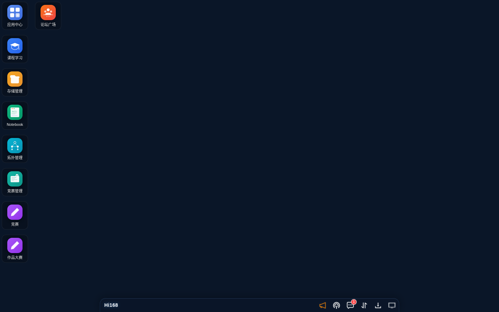
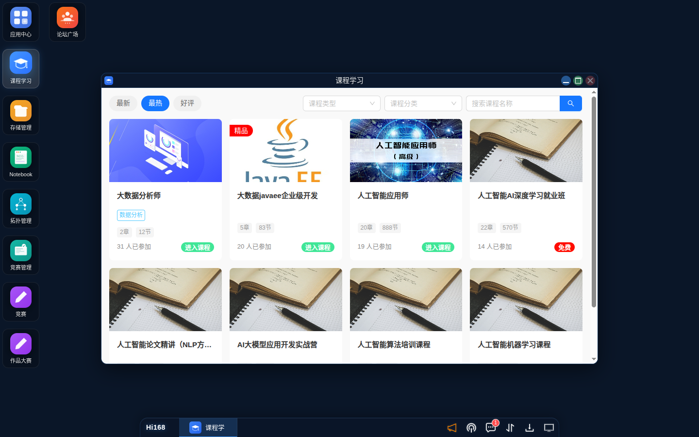
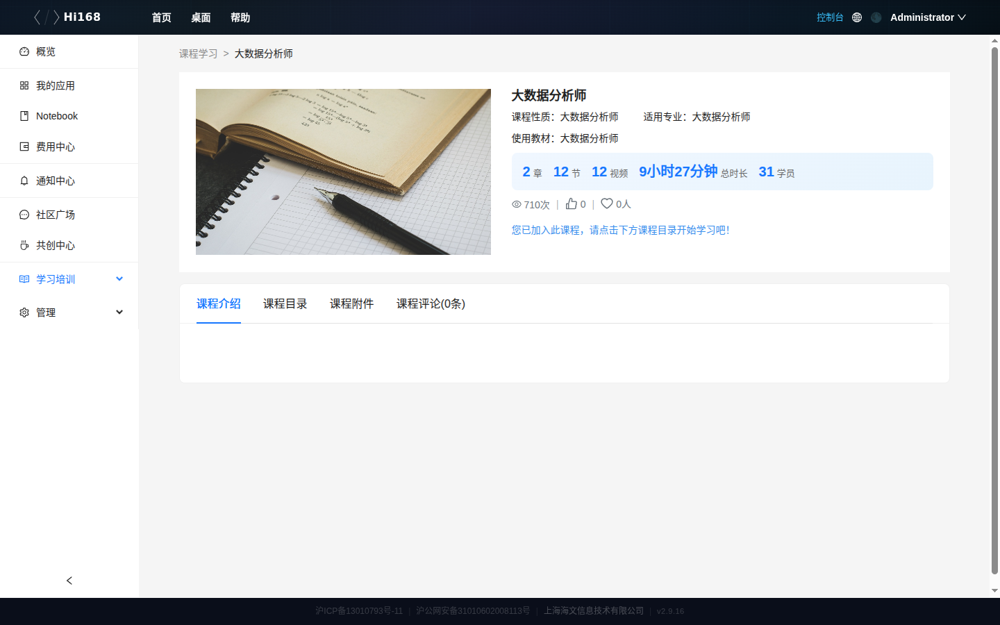
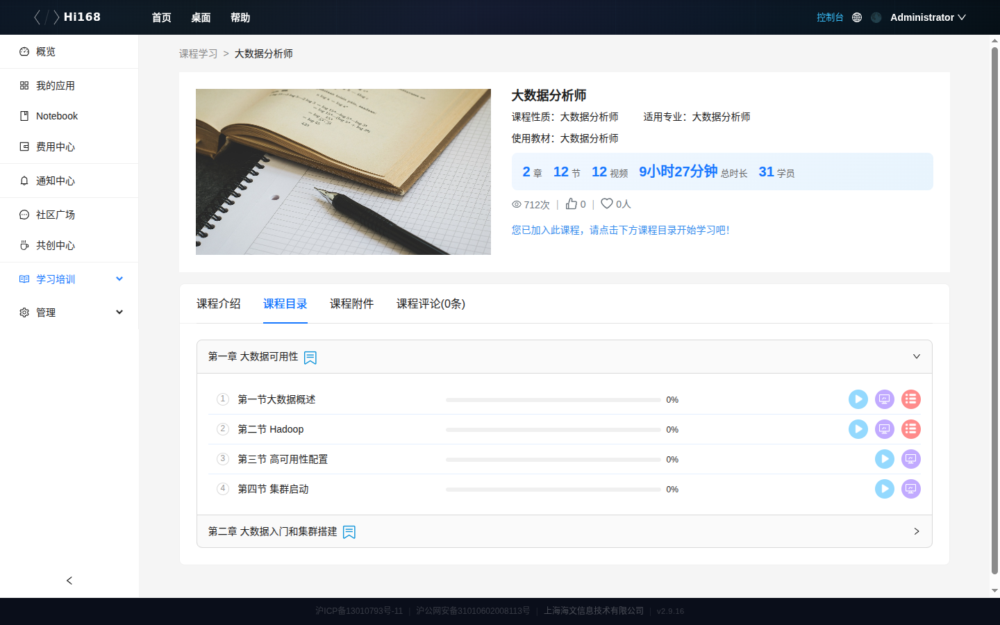
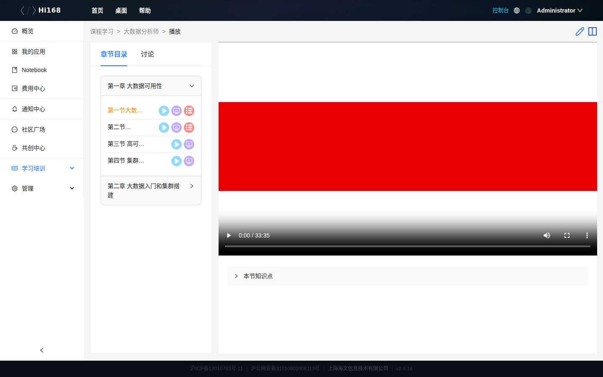
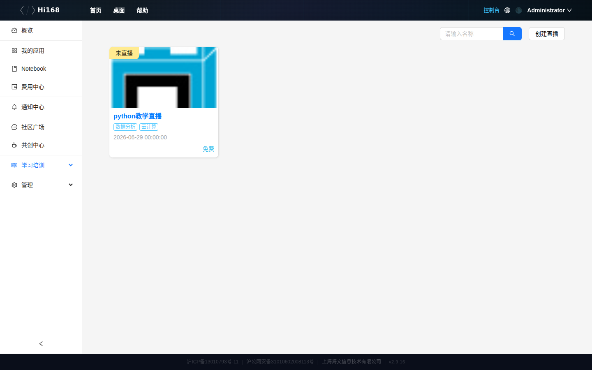
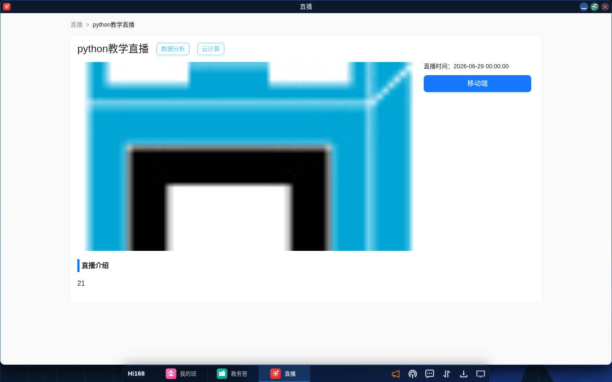
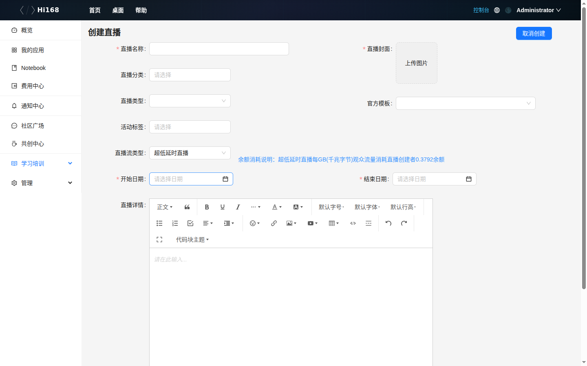
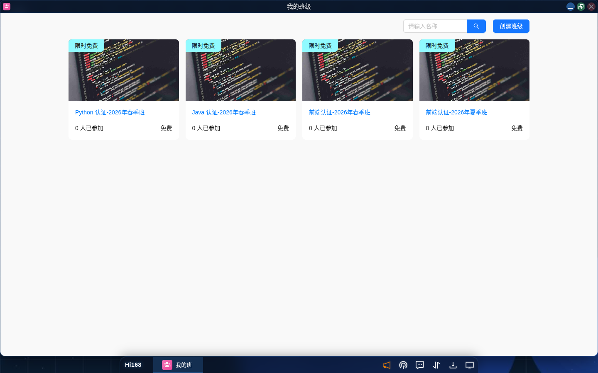
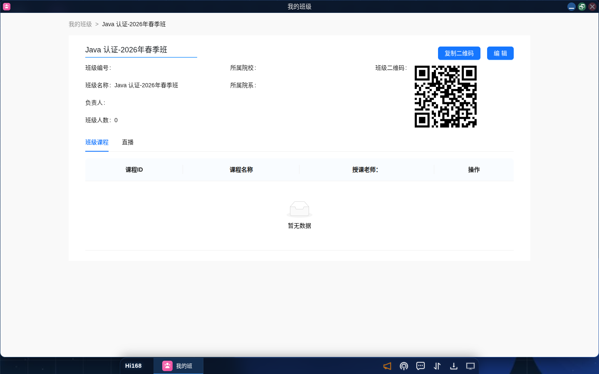

# 在线学习

## 概述

Hi168 平台的在线学习模块为学习者提供课程浏览、加入学习、视频播放、章节练习、直播互动与班级学习等能力。课程按章节组织，每节可包含 **视频、练习、课件、讨论** 四种内容。

> **入口名称说明**：桌面图标名为「课程学习」；控制台左侧导航为「学习培训 → 课程学习」。两者打开的是同一模块。

---

## 一、入口

| 入口 | 路径 |
| --- | --- |
| 桌面图标 | 桌面第一行「课程学习」→ 打开课程学习窗口 |
| 控制台 | 控制台 → 左侧「学习培训」→「课程学习」 |
| 直播 | 控制台 →「学习培训」→「直播」 |
| 我的班级 | 控制台 →「学习培训」→「我的班级」 |

---

## 二、课程学习

### 2.1 课程列表

课程列表展示所有已发布课程，顶部提供筛选：

| 筛选 | 说明 |
| --- | --- |
| **最新 / 最热 / 好评** | 按发布时间、学习人数、评价排序 |
| **课程类型** | 按课程类型筛选（如就业班、认证课等，以页面选项为准） |
| **课程分类** | 按技术方向筛选（人工智能、数据分析等） |

每张课程卡片展示课程名称、分类、章数/节数、已参加人数，右下角为 **进入课程**；课程右上角可能带有「免费」「精品」等标签。

> **搜索**：当前版本课程列表以分类筛选为主；如需按名称查找，可使用页面顶部搜索（若有）或直接在浏览器中搜索课程名。

### 2.2 加入课程

| 类型 | 加入方式 |
| --- | --- |
| **免费课程** | 点击「进入课程」即可开始学习 |
| **付费课程** | 需先完成购买；支付成功后课程出现在「我的课程」中 |

> 已加入的课程在详情页会直接显示「您已加入此课程，请点击下方课程目录开始学习吧！」。

### 2.3 课程详情

点击课程名称进入详情页：

页面包含：

| 区域 | 说明 |
| --- | --- |
| **课程头部** | 课程名称、课程性质、适用专业、使用教材 |
| **数据概览** | 章数、节数、视频数、总时长、学员数、访问量、收藏、评论 |
| **课程介绍** | 课程概述、教学目标、适用人群 |
| **课程目录** | 按章节列出全部课时，可展开/折叠 |
| **课程附件** | 课程配套资料下载 |
| **课程评论** | 学员评价与反馈 |

> **注意**：当前版本的课程详情通常不含「直播日历」标签；直播安排请在「直播」模块或班级详情中查看。

### 2.4 课程目录

点击「课程目录」标签，章节默认折叠，点击章节标题展开：

每个课时右侧提供四种内容入口：

| 图标 | 内容类型 | 说明 |
| --- | --- | --- |
| ▶ 视频 | 视频课 | 打开播放页观看教学视频 |
| 📝 练习 | 随堂练习 | 打开练习题页面作答 |
| 📄 课件 | 课件 | 在线预览或下载 PPT/PDF 等课件 |
| 💬 讨论 | 讨论 | 进入该课时的讨论区 |

课时左侧显示学习进度（如 `0%`），完成学习后自动更新。

### 2.5 课程播放

点击课时的「视频」进入播放页：

播放页布局：

| 区域 | 说明 |
| --- | --- |
| **顶部标签** | 播放 / 章节目录 / 讨论 |
| **左侧章节栏** | 当前课程全部章节与课时，可快速切换 |
| **中央内容区** | 视频播放器或本节课件内容；无内容时显示「暂无数据」 |
| **右侧知识点** | 当前课时的知识点/实验手册（由课程作者配置，可能为空） |

> **提示**：若视频区域一直黑屏，请检查该课时是否已关联视频（课时配置 `video_id`）；详情可联系课程作者或提交工单。

### 2.6 学习进度

- 课时进度按视频观看/内容浏览记录自动累计；
- 课程详情页的「学员数」「访问量」为全平台统计；
- 个人学习记录可在「我的班级 → 课程」或课程目录中的进度查看。

---

## 三、直播教学

### 3.1 直播列表

控制台 → 学习培训 →「直播」，展示当前账号可见的直播课程，状态包括 **正在直播 / 未直播 / 已结束**。

列表展示：直播标题、直播时间、收费类型（免费/收费）、状态。教师账号右上角有 **创建直播** 按钮。

### 3.2 直播详情

点击直播标题进入详情页：

| 标签页 | 说明 |
| --- | --- |
| **直播** | 直播介绍、直播时间、移动端二维码（扫码观看） |
| **统计** | 观看人数、观看时长等统计 |
| **配置** | OBS 推流地址与推流密钥 |
| **回放** | 直播录制回放（如已开启录制） |

### 3.3 创建直播（教师）

1. 在直播列表点击 **创建直播**；
2. 填写直播信息：

| 字段 | 说明 |
| --- | --- |
| **直播标题** | 直播名称（必填） |
| **标签** | 如「数据分析」「云计算」等 |
| **是否收费** | 免费 / 付费 |
| **直播间密码** | 可设置进入密码 |
| **直播介绍** | 直播内容说明 |
| **直播日期 / 时间** | 开场时间与时长 |
| **关联班级** | 可指定班级 |
| **录制直播** | 开启后生成回放 |
| **禁止学员打开麦克风** | 教学场景建议开启 |

3. 点击 **保存**；
4. 到达直播时间后，在详情页 **配置** 中复制推流地址与密钥，使用 OBS 推流。

### 3.4 编辑与删除直播

教师可在直播列表或详情页编辑标题、时间、介绍等信息；不再需要的直播可删除。

### 3.5 移动端观看

直播详情页右侧提供移动端二维码（微信小程序），学员扫码即可在手机观看。

### 3.6 直播回放

开启「录制直播」后，直播结束会自动生成回放，可在详情页「回放」标签中查看。

---

## 四、我的班级（学生视角）

### 4.1 班级列表

控制台 → 学习培训 →「我的班级」，展示学生已加入的班级卡片（班级名称、人数、收费类型）。

### 4.2 班级详情

点击班级卡片进入详情：

| 标签页 | 说明 |
| --- | --- |
| **班级详情** | 班级编号、名称、负责人、人数、所属院校/院系、班级二维码 |
| **课程** | 班级关联的课程列表（可进入学习） |
| **直播** | 班级内的直播安排 |
| **讨论** | 班级讨论区（消息/主题） |
| **学生** | 班级学生名单 |

> 学生通常只能查看班级信息与学习内容；创建/编辑班级需要教师或教务权限，见「教学管理 → 教务管理」。

---

## 五、学习路径建议

1. **浏览课程中心**：按分类或排序找到目标课程；
2. **进入课程**：免费课程直接进入，付费课程先购买；
3. **按章节学习**：视频 + 练习 + 课件 + 讨论组合使用；
4. **参与直播**：在「直播」模块查看时间，扫码或网页观看；
5. **复习巩固**：回放、课件与讨论区留言；
6. **实验实践**：课程中的实验环境由教师关联的应用模板创建，可在播放页一键部署（以实际课程配置为准）。

---

## 六、常见问题

| 问题 | 解决办法 |
| --- | --- |
| 桌面找不到「课程学习」图标 | 点击 Hi168 启动菜单，在列表中选择安装 |
| 课程加入后看不到 | 刷新「课程学习」；确认使用的是报名/购买的同一账号 |
| 视频黑屏或无法播放 | 检查课时是否关联视频；换浏览器或关闭广告拦截插件 |
| 练习打不开 | 该课时可能未配置练习；联系授课教师 |
| 直播看不到推流配置 | 只有直播创建者/教师能看到「配置」标签 |
| 扫码后无法观看直播 | 确认直播未开始或已结束；检查小程序是否最新版本 |
| 班级列表为空 | 尚未被加入班级；请联系班主任或管理员 |