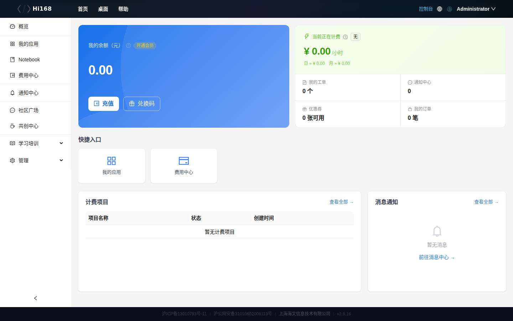
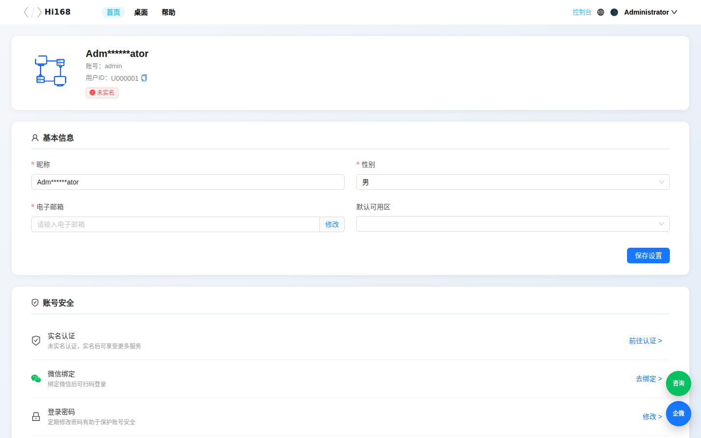
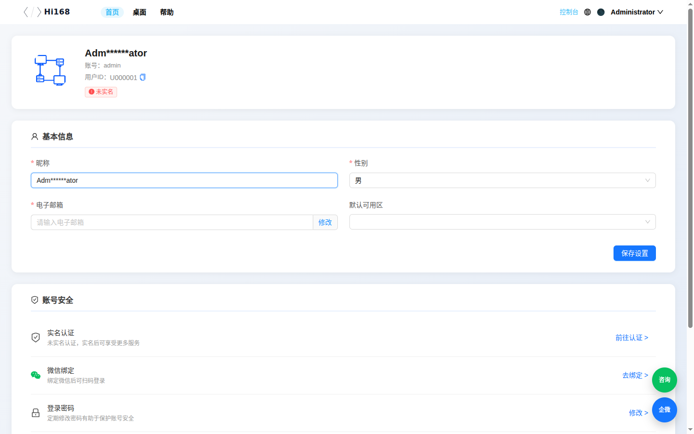
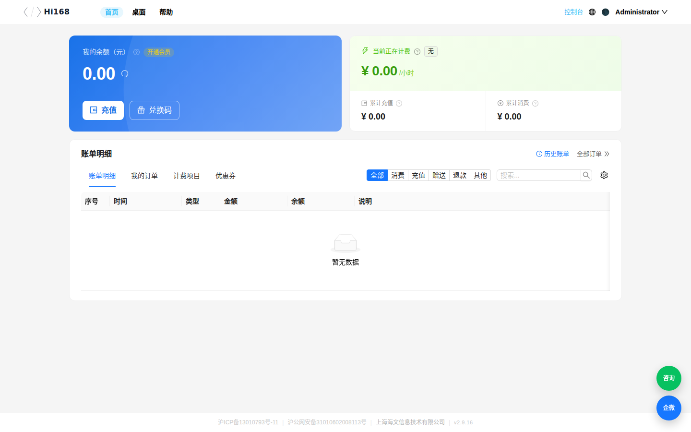
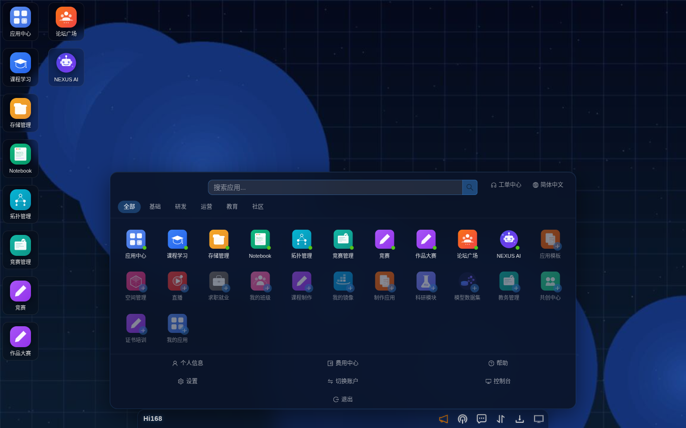
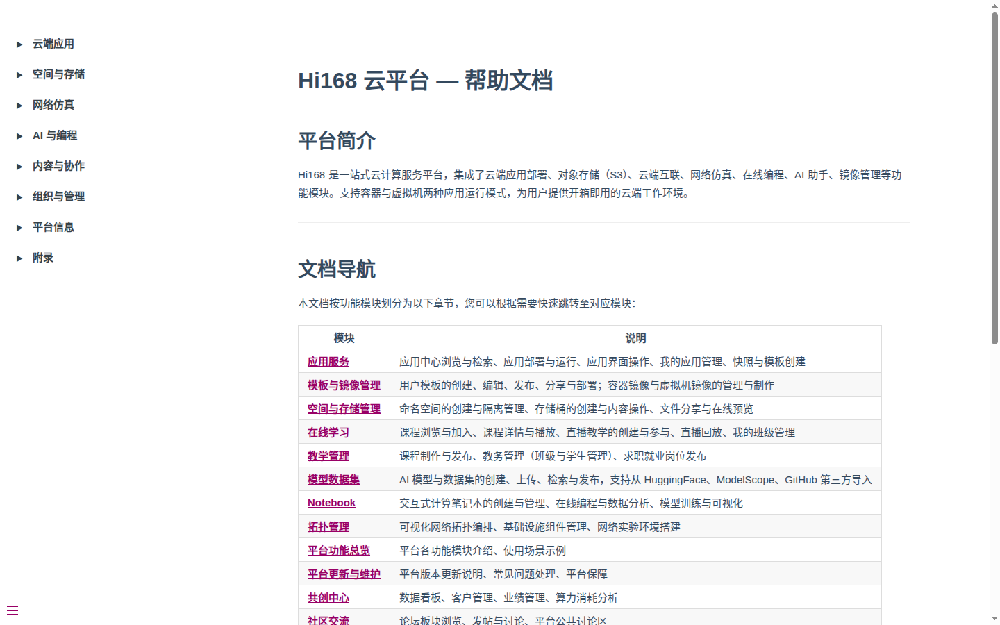

# 平台与个人设置

## 概述

Hi168 平台的 **云桌面中心** 是所有功能模块的统一入口。本章介绍桌面中心的使用，以及个人信息、费用中心、桌面设置、云端互联、帮助等系统级功能。

---

## 一、桌面中心

### 1.1 界面说明

登录后进入云桌面。桌面采用类操作系统布局：

| 区域 | 说明 |
| --- | --- |
| **顶部导航** | 首页、桌面、帮助、控制台、语言、主题切换、账号菜单 |
| **左侧启动栏** | 常用模块图标（应用中心、课程学习、存储管理、Notebook、拓扑管理、竞赛管理、竞赛、作品大赛、论坛广场） |
| **桌面图标区** | 已安装的应用与快捷方式，双击/单击打开 |
| **底部任务栏** | 已打开窗口、Hi168 启动按钮、通知中心、时钟 |

### 1.2 启动菜单（Hi168 按钮）

点击桌面左下角的 **Hi168** 按钮打开启动菜单。菜单按类别组织所有模块：

| 分类 | 模块 |
| --- | --- |
| **基础** | 应用中心、课程学习、存储管理、Notebook、拓扑管理、竞赛管理、竞赛、作品大赛、论坛广场、NEXUS AI |
| **研发** | 应用模板、空间管理、我的镜像、制作应用、科研模块、模型数据集 |
| **教育** | 直播、求职就业、我的班级、课程制作、教务管理、证书培训 |
| **社区 / 运营** | 共创中心、我的应用、个人信息、费用中心、帮助、设置、切换账户、控制台、退出 |

> 首次点击未安装的模块会提示「已安装，点击即可打开」，安装后图标会固定在桌面。

### 1.3 控制台

点击顶部 **控制台** 进入控制台布局，左侧导航包含：概览、我的应用、Notebook、费用中心、通知中心、社区广场、共创中心、学习培训、管理。

---

## 二、个人信息

### 2.1 入口

启动菜单 →「个人信息」；或控制台账号菜单 →「个人中心」。

### 2.2 个人主页

个人中心左侧菜单：

| 菜单 | 说明 |
| --- | --- |
| **个人主页** | 头像、账号、用户 ID、个人简介 |
| **我的订单** | 订单与支付记录 |
| **发票管理** | 发票抬头与开票记录 |
| **消息提醒** | 系统通知与消息设置 |
| **优惠券** | 可用/已用优惠券 |
| **实名认证** | 实名认证状态与认证入口 |
| **账号设置** | 密码、手机号、邮箱等账号安全设置 |

### 2.3 账号设置

点击「账号设置」可修改头像、账号名称、手机号、密码与邮箱；修改后点击 **保存**。

> **安全提示**：修改手机号/邮箱需要完成验证码校验；请勿在公共设备上保存密码。

---

## 三、费用中心

### 3.1 入口

启动菜单 →「费用中心」；或控制台「费用中心」。

### 3.2 页面信息

| 区域 | 说明 |
| --- | --- |
| **我的余额** | 当前可用余额；提供「充值」「兑换码」「开通会员」 |
| **当前正在计费** | 正在运行并扣费的资源与每小时费用 |
| **消耗预估** | 按日 / 月 / 年估算消耗（时、日、月、年切换） |
| **累计充值 / 累计消费** | 历史汇总 |
| **账单明细** | 充值、消费、退款记录，可按时间筛选 |
| **充值方式** | 支付宝 / 微信支付 |

> 计费规则见 [附录 · 计费规则](./appendix.md)。

---

## 四、桌面设置

启动菜单 →「设置」，打开「设置桌面」对话框：

### 4.1 桌面设置

| 设置项 | 说明 |
| --- | --- |
| **壁纸** | 上传图片、从系统壁纸中选择，或恢复默认壁纸 |
| **开机自动加载应用** | 登录后自动启动指定应用 |
| **窗口动画速度** | 调整窗口打开/关闭动画快慢 |

### 4.2 系统设置

| 设置项 | 说明 |
| --- | --- |
| **桌面名称** | 自定义桌面显示名称 |
| **邮箱通知** | 开启后平台通知会同时发送到绑定邮箱 |
| **运行模式** | 高性能 / 节能等模式（以实际选项为准） |
| **语言** | 简体中文 / English |
| **缓存清理** | 清理本地缓存 |

### 4.3 开关机计划

可设置定时开机、关机（如教学实验室统一开关机），到点自动执行。

> **提示**：桌面设置保存在当前账号；更换浏览器或清除缓存后如未生效，重新登录即可。

---

## 五、云端互联

### 5.1 功能说明

云端互联（Cloud Link）通过 VPN 通道把本地电脑与云端环境打通。用户可在本地直接用 SSH、IDE、浏览器访问云端虚拟机与内网服务，无需在本地安装虚拟机。

### 5.2 核心特性

| 特性 | 说明 |
| --- | --- |
| **本地与云端互通** | 本地可直接访问云端虚拟机的网络服务 |
| **免本地安装** | 无需在本地装虚拟机，节省本地资源 |
| **低配高用** | 低配置电脑也能使用云端高性能环境 |
| **多协议支持** | SSH、HTTP、数据库等基于 IP 的服务均可访问 |

### 5.3 典型场景

1. 本地终端 `ssh` 连接云端 Linux 虚拟机；
2. VS Code Remote SSH 直接编辑云端代码；
3. 本地浏览器访问云端 Web 服务；
4. 本地数据库客户端连接云端数据库。

### 5.4 入口

> 当前版本的启动菜单中未单独列出「Cloud Link」。可先安装对应客户端（平台提供下载），或在应用中心搜索「Cloud Link / 云端互联」相关应用。具体入口以账号权限与平台版本为准。

---

## 六、帮助

### 6.1 功能说明

点击顶部 **帮助** 或启动菜单「帮助」，会在新标签页打开在线帮助文档（本文档）。

帮助文档左侧按模块分组：云端应用、空间与存储、网络仿真、AI 与编程、内容与协作、组织与管理、平台信息、附录。

### 6.2 使用建议

- 按左侧目录查找对应模块；
- 使用浏览器 `Ctrl+F` 在当前页搜索关键字；
- 文档中的截图与当前版本界面一致，可直接对照操作。

---

## 七、常见问题

| 问题 | 解决办法 |
| --- | --- |
| 余额不足 | 费用中心 →「充值」；或使用兑换码 |
| 桌面设置未生效 | 刷新页面或重新登录；清除缓存后重试 |
| 启动菜单找不到某个模块 | 在启动菜单中搜索/按分类查找，首次点击会安装到桌面 |
| 桌面图标太多找不到 | 用顶部搜索，或右键桌面整理图标 |
| 云端互联无法连接 | 确认客户端已安装、VPN 已连接；检查本地网络与防火墙 |
| 修改个人信息失败 | 检查必填项与格式；手机号/邮箱需通过验证码校验 |
| 帮助文档打不开 | 检查浏览器是否拦截新标签页；直接访问 `/help/` |