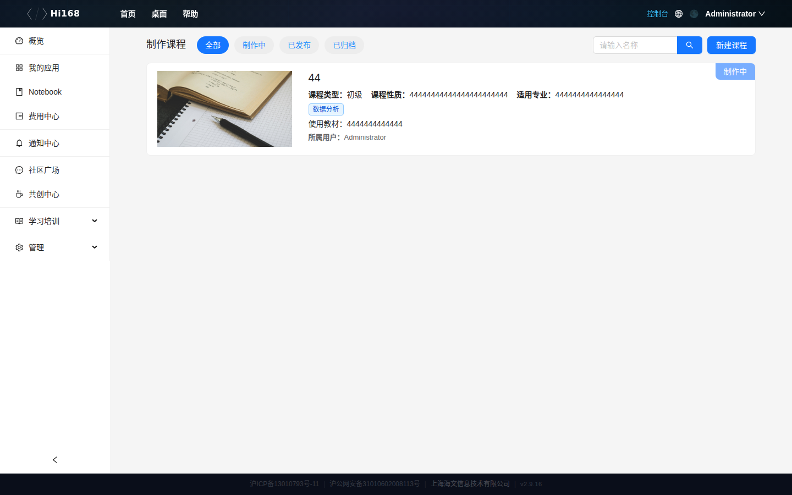
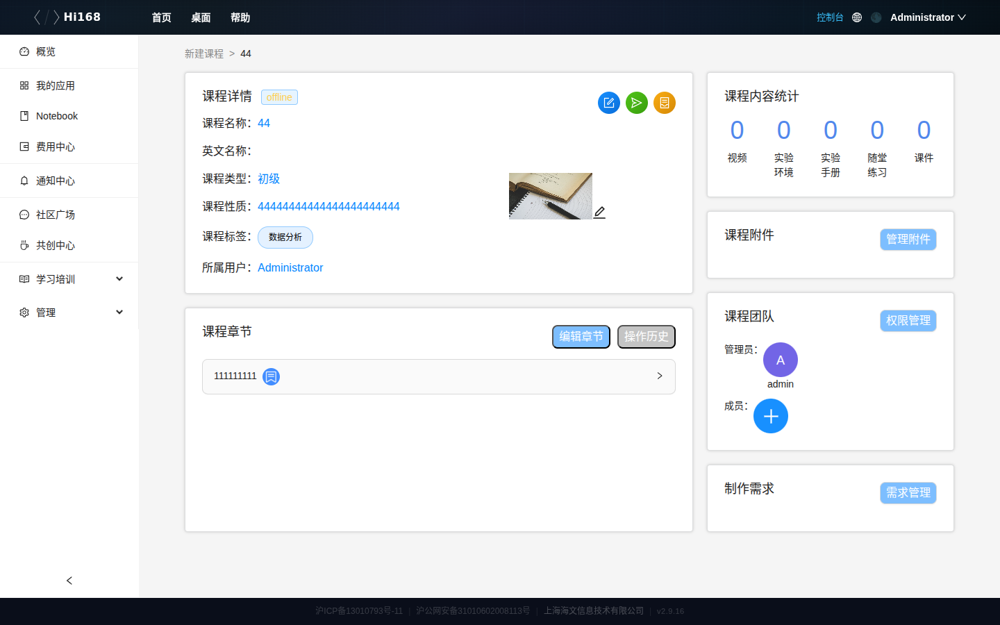
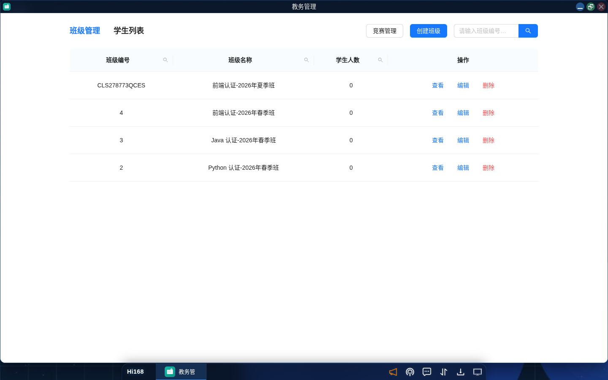
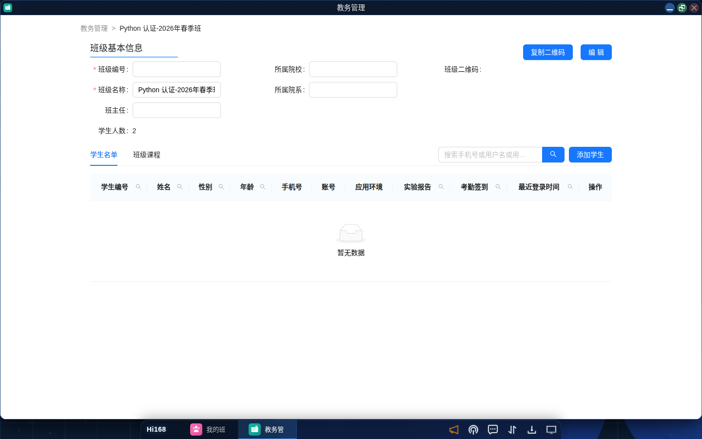
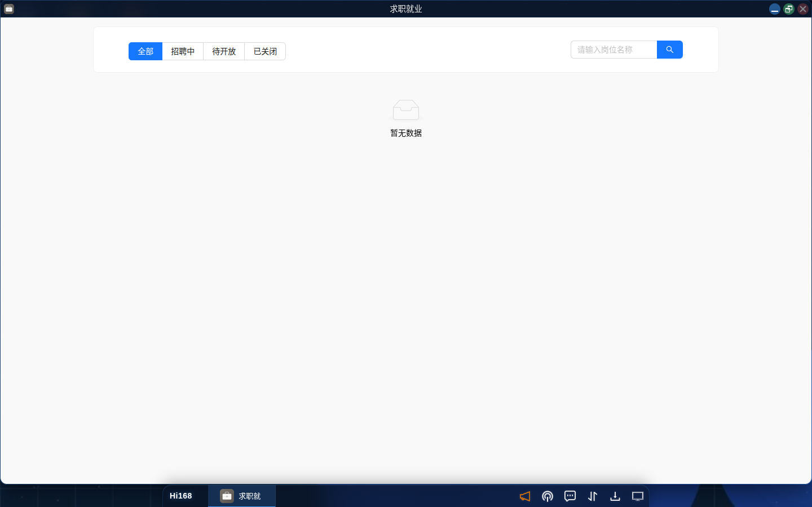

# 教学管理

## 概述

教学管理模块面向教师与教务人员，覆盖 **课程制作、教务管理、求职就业** 三条业务线。入口均在控制台左侧「管理」分组，或桌面启动菜单。

| 模块 | 入口 | 主要用途 |
| --- | --- | --- |
| **课程制作** | 控制台 → 管理 → 课程制作 | 建课、编辑章节与课时、发布课程 |
| **教务管理** | 控制台 → 管理 → 教务管理 | 班级管理、学生名单、班级课程 |
| **求职就业** | 控制台 → 管理 → 求职就业 | 发布岗位、查看岗位状态 |

> **权限说明**：课程制作与教务管理需要教师/教务相关角色；普通学生账号看不到「管理」分组。

---

## 一、课程制作

### 1.1 课程列表

进入「课程制作」后，顶部按状态筛选：

| 标签 | 说明 |
| --- | --- |
| **全部** | 当前账号创建的所有课程 |
| **制作中** | 编辑中、未发布 |
| **已发布** | 已上架到课程学习 |
| **已归档** | 已下架，不再展示 |

右上角 **新建课程** 用于创建新课。列表以卡片展示课程类型、课程性质、适用专业、分类、使用教材、所属用户等信息。



### 1.2 新建课程

1. 点击 **新建课程**；
2. 填写课程名称、课程性质、适用专业、分类、难度、使用教材等基础信息；
3. 保存后进入课程详情，继续编辑大纲与课时。

### 1.3 课程详情与编辑

点击课程卡片进入详情：



可编辑的内容包括：

| 区域 | 说明 |
| --- | --- |
| **基础信息** | 课程名称、简介、封面、分类、难度 |
| **课程大纲** | 新增/编辑/删除章节，调整章节与课时顺序 |
| **课时内容** | 视频、练习、课件、讨论、实验手册、知识点 |
| **课程资料** | 关联应用模板、案例、课件、视频 |
| **协作与权限** | 添加协作成员、设置可见范围 |
| **需求管理** | 建课需求与任务跟踪 |

> 课时编辑入口：课程详情 → 章节 → 课时右侧「编辑」；练习需在课时编辑页的「练习」标签中配置。

### 1.4 发布课程

课程内容完成后：

1. 检查大纲与每个课时的资源是否齐全；
2. 预览课程播放页；
3. 在课程详情或列表执行「发布」；
4. 发布后课程出现在「课程学习」列表中（状态变为「已发布」）。

> **建议**：发布前用一个学生账号实际走一遍：进入课程 → 打开视频 → 做题 → 查看课件。

---

## 二、教务管理

### 2.1 入口与界面

控制台 → 管理 →「教务管理」，顶部两个标签：

| 标签 | 说明 |
| --- | --- |
| **班级管理** | 班级列表与班级详情 |
| **学生列表** | 学生信息查询与维护 |



### 2.2 班级列表

列表字段：班级编号、班级名称、学生人数、操作（查看 / 编辑 / 删除）。右上角 **创建班级**。

### 2.3 创建班级

1. 点击 **创建班级**；
2. 填写班级名称、所属院校/院系、班主任等信息；
3. 保存后可在班级详情中「添加学生」；
4. 班级创建后生成班级二维码，学生可扫码加入（以实际权限配置为准）。

### 2.4 班级详情

点击「查看」进入班级详情：



| 区域 | 说明 |
| --- | --- |
| **基本信息** | 班级编号、名称、班主任、人数、院校、院系 |
| **班级二维码** | 复制/展示给学生扫码加入 |
| **学生名单** | 学生编号、姓名、性别、年龄、手机号、账号、应用环境、实验报告、考勤、最近登录时间 |
| **班级课程** | 班级关联的课程列表 |
| **添加学生** | 从学生库中选择学生加入班级 |
| **编辑** | 修改班级信息 |

> **学生名单为空**：说明尚未添加学生，或学生未完成加入流程；可点击「添加学生」手动添加，或让学生扫码加入。

### 2.5 学生列表

切换到「学生列表」可查看学生基本信息：学生编号、姓名、性别、手机号、所属院校、专业、学习内容、开课学期、作业、实验报告、签到、应用环境、平时成绩、考试成绩、学期成绩。

> 需要先在班级详情中选中班级，部分学生数据按班级维度展示。

### 2.6 班级与课程的关系

```
创建班级 → 添加学生 → 关联课程 → 安排直播 → 跟踪学习/实验/考勤
```

- 班级详情「班级课程」中可添加课程；
- 课程加入班级后，学生在「我的班级 → 课程」中即可学习；
- 直播可通过「直播 → 创建直播 → 关联班级」绑定。

---

## 三、求职就业

### 3.1 岗位列表

控制台 → 管理 →「求职就业」，顶部按状态筛选：**全部 / 招聘中 / 待开放 / 已关闭**。



### 3.2 发布岗位

1. 点击 **发布职位**；
2. 填写岗位名称、类别、职责描述、任职要求、薪资范围、工作地点等；
3. 选择状态（招聘中 / 待开放）；
4. 保存后岗位出现在列表中。

### 3.3 编辑与关闭

对已发布岗位可编辑内容或关闭招聘；关闭后状态变为「已关闭」，不再对学生展示为可投递。

> **提示**：当前版本的岗位数据为空时不显示列表；发布后才会出现记录。

---

## 四、教学管理工作流

```
新建课程 → 编辑大纲/课时 → 关联资源 → 发布课程
                                    ↓
创建班级 → 添加学生 → 关联课程 → 安排直播 → 跟踪学习效果
                                    ↓
                             发布岗位 / 就业服务
```

1. **课程准备**：建课、写大纲、录视频、配练习与课件；
2. **课程发布**：预览并发布到课程学习；
3. **教务组织**：建班、加学生、关联课程；
4. **教学实施**：直播授课、查看考勤与实验报告；
5. **就业服务**：发布岗位，协助学生就业。

---

## 五、常见问题

| 问题 | 解决办法 |
| --- | --- |
| 看不到「管理」分组 | 当前账号不是教师/教务角色；联系管理员分配角色 |
| 创建的班级学生看不到 | 确认学生已加入班级；检查班级是否关联了课程 |
| 课程发布后学生看不到 | 检查课程状态是否为「已发布」、课程分类是否对学生可见 |
| 课时无法添加视频 | 先在课程资料中上传/关联视频，再在课时中选择 |
| 班级二维码扫不开 | 确认二维码未过期；也可手动把班级编号发给学生 |
| 学生列表为空 | 先在班级详情中添加学生；部分数据按班级展示 |
| 岗位发布后列表仍为空 | 刷新页面；确认岗位状态为「招聘中」 |