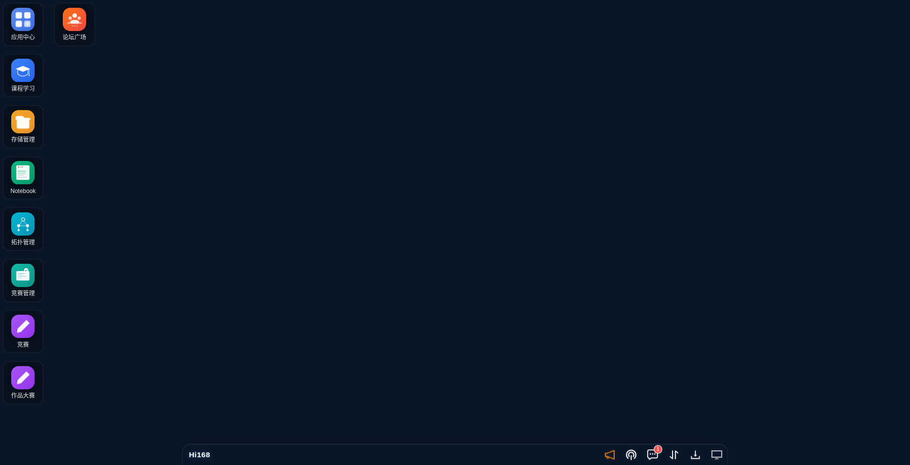
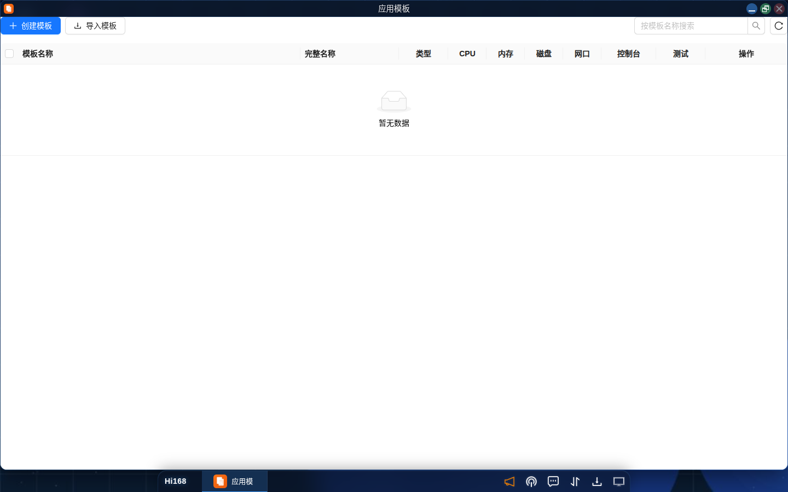
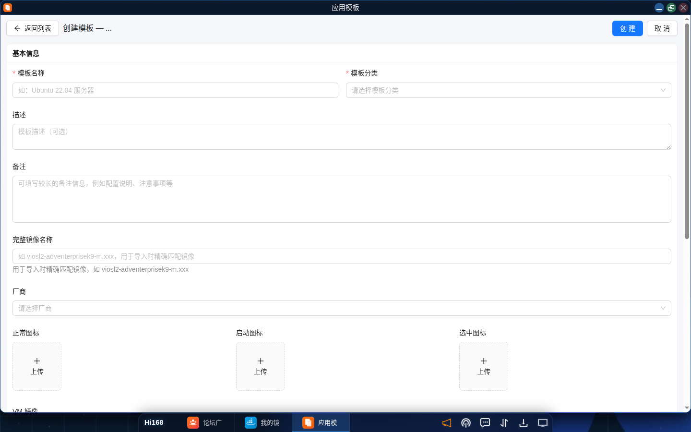
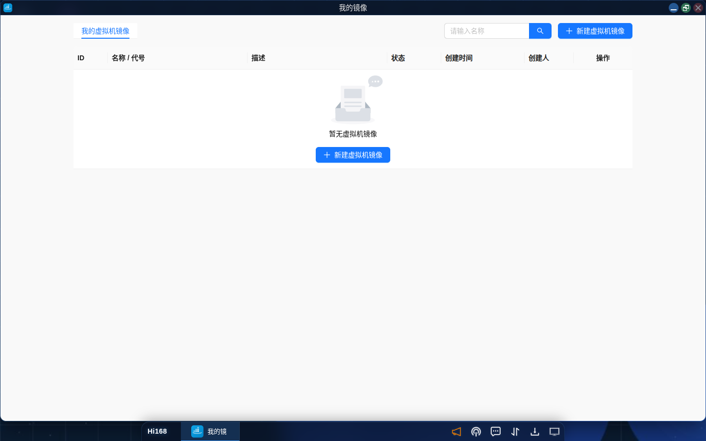

# 模板与镜像管理

## 概述

Hi168 平台提供 **模板管理** 与 **镜像管理** 能力，用于复用与分发应用环境：

- **应用模板**：把配置好的应用环境保存为模板，后续一键部署；
- **我的镜像**：管理容器镜像、虚拟机镜像与应用镜像，是模板制作的底层资源。

典型工作流：

```
镜像拉取/上传 → 镜像管理 → 制作应用模板 → 编辑模板 → 部署测试 → 发布/分享
```

---

## 一、入口

| 功能 | 入口 |
| --- | --- |
| 应用模板（我的模板） | 启动菜单（Hi168）→「应用模板」；或桌面第一列图标 |
| 我的镜像 | 启动菜单 →「我的镜像」 |
| 制作应用 | 启动菜单 →「制作应用」 |



> 首次使用某模块时，启动菜单会提示「已安装，点击即可打开」；安装后图标会固定在桌面上。

---

## 二、应用模板

### 2.1 模板列表

打开「应用模板」后，列表展示当前账号创建的模板：

| 列 | 说明 |
| --- | --- |
| **ID** | 模板唯一标识 |
| **名称** | 模板名称 |
| **完整名称** | 模板的完整标识（含版本/命名空间） |
| **类型** | `Basic`（基础模板）/ `Docker`（容器模板） |
| **描述** | 模板简介 |
| **创建人 / 创建时间** | 模板归属与创建时间 |
| **操作** | 部署、编辑、发布、分享、删除等 |



### 2.2 创建模板

点击右上角 **创建模板**，填写：

| 字段 | 必填 | 说明 |
| --- | --- | --- |
| **模板名称** | 是 | 模板显示名称 |
| **类型** | 是 | `Basic` 基础模板 / `Docker` 容器模板 |
| **描述** | 否 | 模板用途与包含的软件环境 |
| **系统盘** | 是 | 基础模板的系统盘大小 |
| **Docker/OCI 镜像地址** | Docker 类型必填 | 如 `nginx:latest`，测试启动时直接从 registry 拉取，无需下载到 PVC |
| **CPU / 内存** | 是 | 默认计算资源 |
| **磁盘大小** | 是 | 数据盘大小（默认 10 GB） |
| **网卡驱动** | 是 | 默认 `virtio` |
| **控制台方式** | 是 | 默认 `Console`，可选 VNC |
| **高级选项** | 否 | 其他启动参数 |



### 2.3 模板状态

| 状态 | 说明 |
| --- | --- |
| **制作中** | 模板正在生成，暂不可部署 |
| **已发布** | 已发布到应用中心，所有用户可见 |
| **已归档** | 已下架，不再对外展示 |

### 2.4 发布与分享

- **发布**：将模板发布到应用中心，供平台用户搜索和使用。发布前建议先「部署」测试。
- **分享**：分享给指定用户或全部用户；可设置「限定时间」或「长期有效」。分享后模板会出现在对方的「应用模板」列表中。

### 2.5 部署模板

在模板列表点击「部署」，流程与应用中心部署一致：选择部署方式、计费方式、命名空间与资源规格后确认。

---

## 三、我的镜像

### 3.1 镜像类型

「我的镜像」包含三个标签页：

| 标签页 | 说明 |
| --- | --- |
| **虚拟机镜像** | 完整操作系统镜像（qcow2 等），用于创建虚拟机型应用 |
| **容器镜像** | Docker/OCI 镜像，用于容器型应用 |
| **应用镜像** | 由应用/模板制作流程生成的镜像 |



### 3.2 虚拟机镜像列表

| 列 | 说明 |
| --- | --- |
| **ID** | 镜像唯一标识 |
| **名称 / 代号** | 镜像名称与短代号 |
| **描述** | 镜像内容说明 |
| **状态** | 制作中 / 可用 / 失败 |
| **创建时间 / 创建人** | 镜像归属信息 |
| **操作** | 编辑、制作应用模板、删除 |

### 3.3 新建虚拟机镜像

1. 在「虚拟机镜像」标签页点击 **新建虚拟机镜像**；
2. 填写名称、代号、描述；
3. 选择或上传镜像文件（或填写镜像地址）；
4. 确认提交，等待镜像制作完成；
5. 制作完成后点击 **制作应用模板**，基于该镜像生成可部署的模板。

### 3.4 容器镜像

在「容器镜像」标签页可查看已拉取的容器镜像。新建容器镜像时填写仓库地址、镜像名称与 Tag，系统从远程仓库拉取到平台本地仓库，供模板制作使用。

> **提示**：拉取私有镜像前需配置仓库凭据；镜像较大时拉取时间较长，请耐心等待。

### 3.5 镜像详情与删除

点击镜像名称进入详情页，可查看完整元数据并编辑名称、描述。删除镜像前请确认没有模板或运行中的应用依赖它。

---

## 四、制作应用

「制作应用」用于把镜像或模板组装为可发布的应用。入口：启动菜单 →「制作应用」。制作完成后可在应用中心发布，供其他用户部署。

---

## 五、注意事项

- 模板制作时间取决于镜像大小，大型镜像可能需要数分钟。
- 发布前务必先部署测试，确认端口、启动命令、资源规格可用。
- 删除镜像前确认无模板或运行中的应用依赖。
- 分享模板设置有效期，过期后接收用户将无法继续使用。
- 模板与镜像占用存储空间，长期不用请及时清理。

---

## 六、常见问题

| 问题 | 解决办法 |
| --- | --- |
| 模板一直显示「制作中」 | 查看镜像是否拉取完成；超过 30 分钟请提交工单 |
| 部署模板后应用启动失败 | 检查镜像启动命令、端口配置与资源规格 |
| 分享的模板对方看不到 | 确认分享对象与有效期；对方需登录后在「应用模板」中查看 |
| 删除模板失败 | 先删除基于该模板创建的应用实例 |
| 容器镜像拉取失败 | 检查仓库地址、Tag 与凭据；确认网络可访问镜像仓库 |