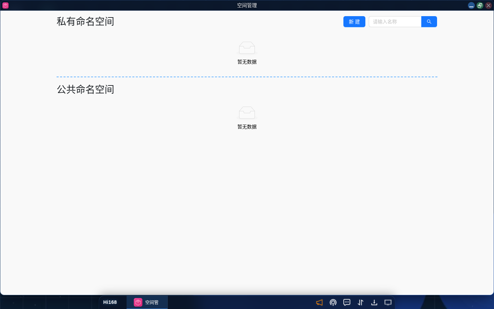

# 空间管理

## 概述

Hi168 平台通过 **命名空间（Namespace）** 隔离不同实验或项目的运行环境与资源，避免相互冲突。每个命名空间可包含该实验/项目所需的应用、数据与其他资源。

## 一、入口

| 入口 | 路径 |
| --- | --- |
| 启动菜单 | 桌面左下角 **Hi168** →「空间管理」 |
| 桌面图标 | 安装后出现在桌面，单击打开 |

## 二、界面说明

「空间管理」窗口包含两个标签页：

| 标签页 | 说明 |
| --- | --- |
| **私有命名空间** | 用户专属命名空间，拥有独立控制权，可查看其中的应用与可用硬件资源（CPU / 内存） |
| **公共命名空间** | 多人共享的空间，适用于团队协作；可见范围由管理员配置 |

右上角 **新建** 按钮用于创建命名空间。

## 三、创建命名空间

1. 进入「空间管理」；
2. 在目标标签页（私有 / 公共）点击 **新建**；
3. 填写空间名称（建议使用有意义的英文/拼音名称）；
4. 确认创建；
5. 创建后该空间会出现在列表中，部署应用时可在「命名空间」下拉框中选择。

> **提示**：命名空间名称创建后通常不可修改，请按「项目-环境」的规则命名，例如 `course-ai-lab`。

## 四、空间内应用管理

进入某个命名空间（或在列表展开）可查看其中的应用实例，支持：

| 操作 | 说明 |
| --- | --- |
| **查看应用状态** | 运行状态、CPU / 内存占用 |
| **修改应用名称** | 直接编辑显示名称 |
| **调整资源配额** | 修改 CPU / 内存分配 |
| **打开应用** | 进入应用操作窗口 |

> **注意**：调整配额后按新规格计费；删除命名空间前需先清理其中的应用与数据。

## 五、最佳实践

1. **按项目隔离**：不同课程、实验或客户项目分别使用独立命名空间。
2. **规范命名**：使用 `项目名-用途` 形式，避免创建后无法快速辨认。
3. **关注资源**：定期查看空间内的应用数量与资源占用，及时释放不用的实例。
4. **团队协作**：多人场景使用公共命名空间，避免各人重复部署。

## 六、常见问题

| 问题 | 解决办法 |
| --- | --- |
| 部署应用时选不到新空间 | 刷新页面或重新打开应用中心窗口 |
| 公共命名空间不可见 | 公共空间由管理员分配，无权限时不会显示；请联系管理员 |
| 命名空间可以重命名吗 | 当前版本不支持改名，建议删除后重建（需先清理资源） |
| 空间内应用无法启动 | 检查该空间的 CPU / 内存配额是否已用尽 |